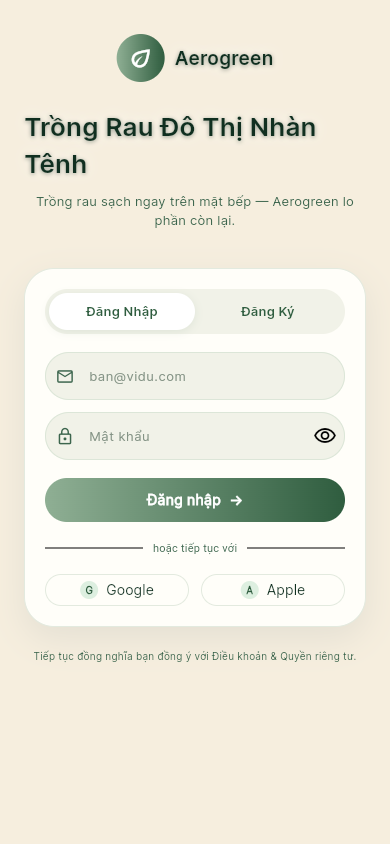
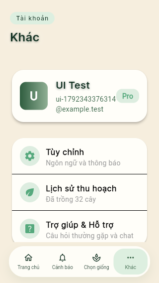
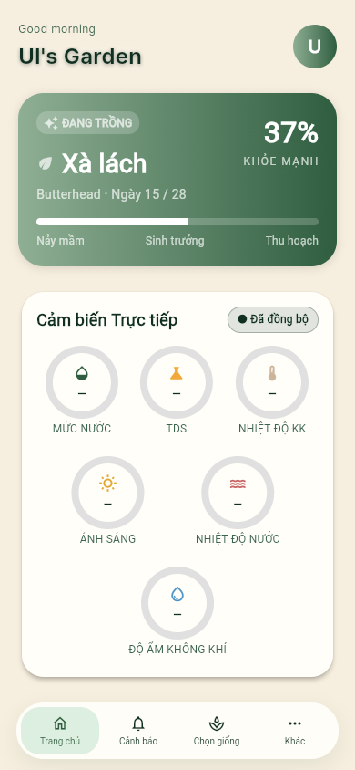

# IOTAgri · Test & QA

**Kết quả kiểm thử, lỗi đã ghi nhận và bằng chứng của IOTAgri.**

**Cập nhật cấu hình mới: main `a3dc757` — 30 PASS / 2 FAIL / 0 skipped.**
[Báo cáo và lỗi cần xử lý](testing/reports/system-e2e/2026-10-30-contract-update/README.md).

Xem [hướng dẫn chọn luồng xác thực](testing/e2e/README.md).
Chỉ thay đổi test; lỗi ứng dụng được báo cáo, không tự sửa.

## Chạy E2E toàn hệ thống ngay sau khi pull

Cài **Git, Node.js 22 và Docker Desktop (Linux containers)**, mở Docker Desktop,
rồi chạy từ gốc repo:

```powershell
git pull --ff-only origin Test
node testing/e2e/scripts/run.cjs
```

Không cần cài Flutter, .NET, Chrome, PostgreSQL, MQTT hay tạo `.env`. Bộ chạy tự
tải main mới nhất và ghi SHA ứng dụng đã kiểm tra, build Docker, tạo DB/MQTT/email test riêng,
chạy 32 ca rồi lưu báo cáo và dọn môi trường. Không sửa code ứng dụng.
Lần đầu cần Internet và dung lượng cho image Flutter/Playwright.

[Hướng dẫn đầy đủ](testing/e2e/README.md) · [Báo cáo E2E 30/10/2026](testing/reports/system-e2e/2026-10-30/README.md)

**Phiên lịch sử trước khi đổi cấu hình: 31 PASS / 1 FAIL / 0 skipped**, đã chạy từ clone sạch, không
cài dependency local và không có source ứng dụng trong gốc nhánh `Test`.
Ca chưa đạt là `WEB-04 / mobile` ở thao tác chọn thời gian chạy bơm;
[xem metadata phiên](testing/reports/system-e2e/2026-10-30/clean-checkout-validation.json).

Phiên trước có **30 PASS / 2 FAIL** và được giữ riêng trong báo cáo lịch sử.
Không cộng gộp kết quả giữa các phiên. Đây là kết quả thật; môi trường sẵn sàng
không có nghĩa là mọi ca đều PASS.

Nhánh `Test` chỉ chạy test thủ công, **không còn GitHub Actions**.
`npm.cmd ci` trong `testing/e2e` chỉ cần cho tiện ích local như `npm.cmd run report`
hoặc `npm.cmd run test:list`; chạy lệnh `node` ở trên không cần bước này.

[Kết quả backend](testing/TEST_REPORT.md) · [Kết quả Flutter](docs/testing/2026-10-18-frontend/README.md) · [Kết quả Web UI](docs/testing/2026-10-19-ui/README.md) · [Thư viện ảnh](docs/testing/2026-10-19-ui/screenshots/README.md)

## Kết quả trong một phút

| Bộ kiểm thử                                           | Phiên đã lưu        |    PASS |   FAIL | TIMEOUT | Điều cần biết                                          |
| ----------------------------------------------------- | ------------------- | ------: | -----: | ------: | ------------------------------------------------------ |
| [System E2E mới nhất](testing/reports/system-e2e/2026-10-30/README.md) | 30/10/2026 · clone sạch · 32 ca | **31** | **1** | 0 | Không sửa code ứng dụng; chạy thủ công bằng Docker |
| [Backend](testing/TEST_REPORT.md)                     | 14/10/2026 · 345 ca | **339** |  **6** |       0 | 4 nhóm lỗi xác nhận; có TRX và coverage                |
| [Flutter](docs/testing/2026-10-18-frontend/README.md) | 18/10/2026 · 133 ca | **133** |      0 |       0 | **57 placeholder**; 76 ca có assertion dữ liệu/hành vi |
| [Web UI](docs/testing/2026-10-19-ui/README.md)        | 19/10/2026 · 33 ca  |  **22** | **10** |   **1** | 11 kịch bản trên 3 viewport; có ảnh và trace           |

> **Cách đọc:** đây là các phiên lịch sử độc lập, không cộng gộp thành một lần chạy. Flutter Chrome bị kẹt loading và chưa kiểm chứng. Báo cáo UI gốc gộp 10 FAIL + 1 TIMEOUT thành **11 ca chưa đạt**. Việc trình bày lại trang này không chạy lại test.

## Tôi muốn xem…

| Nội dung                                           | Mở tại đây                                                                          |
| -------------------------------------------------- | ----------------------------------------------------------------------------------- |
| Ca nào đạt, ca nào chưa đạt theo từng viewport     | [Ma trận kết quả Web UI](docs/testing/2026-10-19-ui/README.md)                      |
| Ảnh giao diện theo kịch bản và kích thước màn hình | [Thư viện 70 ảnh](docs/testing/2026-10-19-ui/screenshots/README.md)                 |
| Báo cáo lỗi để tải về hoặc bàn giao                | [PDF giao diện](docs/testing/2026-10-19-ui/Bao_cao_loi_giao_dien_FE_2026-10-19.pdf) |
| Phạm vi Flutter và các ca placeholder              | [Báo cáo Flutter theo file](docs/testing/2026-10-18-frontend/README.md)             |
| Các lỗi backend và bước tái hiện                   | [Defects & blockers](testing/DEFECTS_AND_BLOCKERS.md)                               |
| Log, TRX, JSON, coverage và trace                  | [Chỉ mục bằng chứng](testing/reports/README.md)                                     |

## Xem nhanh giao diện

Bấm ảnh để mở bản gốc. Đây là ảnh thực tế trong phiên Web UI ngày 19/10/2026.

| Đăng nhập                                                                                                                                                                                         | Tài khoản trên màn hình nhỏ                                                                                                                                                                                     | Ngôn ngữ dashboard                                                                                                                                                                                 |
| ------------------------------------------------------------------------------------------------------------------------------------------------------------------------------------------------- | --------------------------------------------------------------------------------------------------------------------------------------------------------------------------------------------------------------- | -------------------------------------------------------------------------------------------------------------------------------------------------------------------------------------------------- |
| <a href="docs/testing/2026-10-19-ui/screenshots/mobile-UI-01-02.png"></a> | <a href="docs/testing/2026-10-19-ui/screenshots/small-mobile-UI-07-01.png"></a> | <a href="docs/testing/2026-10-19-ui/screenshots/mobile-UI-11-02.png"></a> |

## Các vấn đề cần theo dõi

| Phạm vi        | Vấn đề đã ghi nhận                                                                           | Bằng chứng                                                             |
| -------------- | -------------------------------------------------------------------------------------------- | ---------------------------------------------------------------------- |
| Backend        | Đăng nhập tài khoản khóa; rollback migration; trả lời ticket; validate tên thiết bị          | [4 nhóm lỗi / 6 ca FAIL](testing/DEFECTS_AND_BLOCKERS.md)              |
| Web UI         | Phản hồi đăng nhập lỗi/mất kết nối; nội dung tài khoản vượt màn hình nhỏ; đồng bộ tiếng Việt | [3 nhóm vấn đề / 11 ca chưa đạt](docs/testing/2026-10-19-ui/README.md) |
| Flutter Chrome | Kẹt loading, chủ động dừng trước assertion nghiệp vụ                                         | [Trạng thái và log](docs/testing/2026-10-18-frontend/README.md)        |

## Cấu trúc nhánh

```text
backend/tests/       Mã kiểm thử backend và fixture
frontend/test/       Unit, provider, repository và widget tests
frontend/e2e/        Kịch bản Playwright và công cụ chạy test
docs/testing/        Báo cáo đọc trên GitHub, ảnh và PDF
testing/            Hồ sơ QA backend và hướng dẫn chung
  reports/          Kết quả gốc, coverage, trace và manifest
  guides/           Cách đọc dữ liệu và quy ước đóng góp
  tools/frontend/   Công cụ xuất báo cáo frontend
```

<details>
<summary><strong>Dành cho người chạy lại hoặc bổ sung test</strong></summary>

Nhánh `Test` lưu test và bằng chứng. Cần checkout có mã ứng dụng tương ứng để chạy suite; backend lịch sử dùng revision [`318fca1`](https://github.com/huuanh1411/IOTAgri/tree/318fca181741c95e73b56808ebe04a65a3ee0466), còn môi trường Web UI được ghi trong [environment.json](docs/testing/2026-10-19-ui/environment.json).

| Nhu cầu                              | Hướng dẫn                                                |
| ------------------------------------ | -------------------------------------------------------- |
| Chạy xUnit / PostgreSQL / HTTP tests | [Backend README](backend/README.md)                      |
| Chạy Flutter tests                   | [Frontend README](frontend/README.md)                    |
| Chạy Playwright                      | [E2E README](frontend/e2e/README.md)                     |
| Đọc TRX, registry và coverage        | [Hướng dẫn đọc kết quả](testing/guides/RESULTS_GUIDE.md) |
| Đặt tên, định dạng và bàn giao test  | [Quy ước đóng góp](testing/guides/CONTRIBUTING.md)       |

Từ một checkout ứng dụng sạch, lấy phần kiểm thử bằng:

```powershell
git fetch origin
git restore --source=origin/Test -- backend/tests frontend/test frontend/e2e testing
```

Lưu các chỉnh sửa test local trước khi dùng lệnh restore vì file trùng đường dẫn sẽ bị thay thế.

</details>

Ảnh và Markdown xem trực tiếp trên GitHub; HTML cần tải cùng tài nguyên để mở. Bản bằng chứng công bố đã che mật khẩu/token test. [Manifest SHA-256](testing/reports/evidence-manifest.json) đối chiếu các artifact đã đưa lên nhánh.
