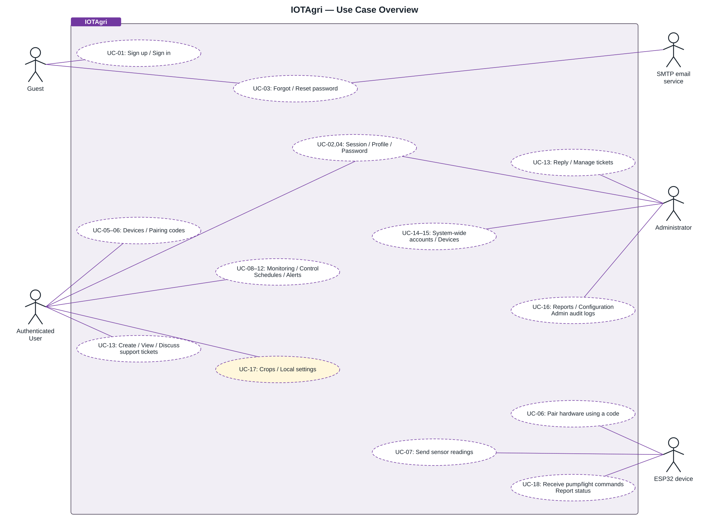

# IOTAgri — Tài liệu hệ thống

**Aerogreen · Giám sát và điều khiển nông nghiệp thủy canh**

Quản lý thiết bị ESP32, theo dõi cảm biến, điều khiển bơm/đèn, đặt lịch, xem cảnh báo và trao đổi hỗ trợ.

[Context Diagram](docs/diagrams/context-diagram.md) · [Use Case](docs/use-cases/README.md) · [ERD](docs/data/README.md) · [SRS](docs/requirements/SRS.md) · [API](docs/reference/api-inventory.md)

> Bạn đang xem tài liệu trên nhánh **`Docs`**. Mã nguồn và hướng dẫn chạy ứng dụng nằm trên nhánh [main](https://github.com/huuanh1411/IOTAgri/tree/main).

## Bắt đầu từ đâu?

| Thứ tự | Tài liệu | Nội dung |
| :---: | --- | --- |
| **01** | [Context Diagram](docs/diagrams/context-diagram.md) | Ranh giới hệ thống, các thực thể bên ngoài và luồng dữ liệu |
| **02** | [SRS — Đặc tả yêu cầu](docs/requirements/SRS.md) | Phạm vi, yêu cầu chức năng, quy tắc và tiêu chí nghiệm thu |
| **03** | [Use Case](docs/use-cases/README.md) | Actor, mục tiêu, luồng chính và ngoại lệ |
| **04** | [ERD và từ điển dữ liệu](docs/data/README.md) | Các bảng, khóa, quan hệ và dữ liệu lưu cục bộ |
| **05** | [Danh mục API](docs/reference/api-inventory.md) | Endpoint, quyền truy cập và truy vết chức năng |

**Chỉ cần xem sơ đồ?** Mở [Context + Use Case + ERD trên một trang](docs/diagrams/project-diagrams.md).

## Context Diagram

IOTAgri ở trung tâm, trao đổi dữ liệu với **Khách, Người dùng, Quản trị viên, ESP32 và SMTP**.

[Giải thích luồng dữ liệu](docs/diagrams/context-diagram.md) · [Mở ảnh để phóng to](docs/diagrams/rendered/system-context.svg) · [Nguồn Mermaid](docs/diagrams/system-context.mmd)

## Use Case

Cả năm actor cùng xuất hiện trong một sơ đồ, dùng chung **một khung hệ thống IOTAgri**. Actor ở ngoài khung; các use case bố trí so le bên trong, nối trực tiếp đến actor tương ứng.

[Xem sơ đồ đầy đủ](docs/diagrams/rendered/use-case.svg) · [Đọc đặc tả UC-01–18](docs/use-cases/README.md) · [Nguồn PlantUML](docs/diagrams/use-case.puml)

Xem trước sơ đồ Use Case tổng quan

## ERD

Mô hình dữ liệu của tài khoản, thiết bị, số đo cảm biến, lịch điều khiển, cảnh báo và phiếu hỗ trợ.

[Xem ERD đầy đủ](docs/diagrams/rendered/erd.svg) · [Đọc từ điển dữ liệu](docs/data/README.md) · [Nguồn Mermaid](docs/diagrams/erd.mmd)

Xem trước ERD tổng quan

## Tra cứu và chỉnh sửa tài liệu

| Nội dung | Đường dẫn |
| --- | --- |
| Toàn bộ tài liệu và quy ước | [Mục lục chi tiết](docs/README.md) |
| Ảnh sơ đồ và nguồn chỉnh sửa | [Thư viện sơ đồ](docs/diagrams/README.md) |
| Mốc source, nguồn đối chiếu và giới hạn | [Source baseline](docs/reference/source-baseline.md) |
| Thay đổi so với tài liệu Docs cũ | [Báo cáo đối chiếu](docs/reviews/2026-10-27-docs-comparison.md) |
| Phạm vi kiểm tra tài liệu | [Ghi nhận kiểm tra](docs/reviews/validation.md) |

Tài liệu nghiệp vụ được đối chiếu với source ngày **27/10/2026**. Nội dung mô tả hiện trạng source; chức năng được triển khai không đồng nghĩa đã nghiệm thu trên môi trường thật. Các giới hạn cục bộ/mock được ghi tại từng tài liệu.
