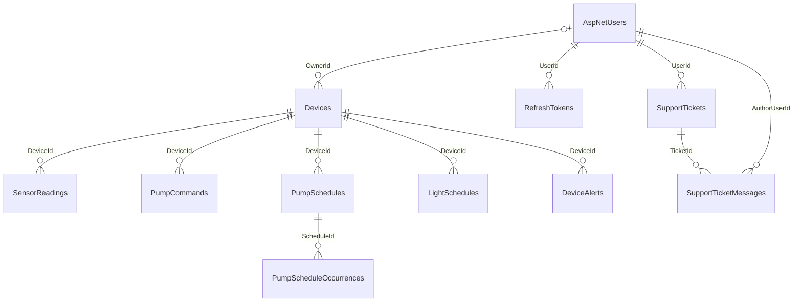

# ERD — Mô hình và từ điển dữ liệu

[← Mục lục](../README.md) · [Sơ đồ ERD đầy đủ](../diagrams/project-diagrams.md#erd) · [Nguồn Mermaid](../diagrams/erd.mmd)

Đối chiếu ApplicationDbContext, Models và ApplicationDbContextModelSnapshot ngày 27/10/2026; không lấy schema từ DB đang chạy. Có **19 bảng: 7 Identity và 12 nghiệp vụ**. Không phát hiện nhu cầu thêm bảng so với ERD cũ trên Docs; bổ sung mô tả trường và quy tắc để tránh hiểu sai.

## Tổng quan quan hệ nghiệp vụ

## Từ điển bảng

| Bảng | Khóa / nội dung | Ghi chú |
| --- | --- | --- |
| AspNetUsers | Id string PK; FullName và các trường Identity | UserName, Email, PasswordHash, PhoneNumber có thể null theo schema; không có nghĩa API đăng ký chấp nhận bỏ email/mật khẩu |
| AspNetRoles | Id PK, Name, NormalizedName | Vai trò được seed: User, Admin |
| AspNetUserRoles | PK ghép UserId/RoleId | FK đến user và role |
| AspNetUserClaims | Id int PK, UserId FK, ClaimType/Value | Claim thuộc user |
| AspNetUserLogins | PK ghép LoginProvider/ProviderKey, UserId FK | Có schema không có nghĩa đã triển khai đăng nhập mạng xã hội |
| AspNetUserTokens | PK ghép UserId/LoginProvider/Name | Bảng Identity; khác RefreshTokens nghiệp vụ |
| AspNetRoleClaims | Id int PK, RoleId FK | Claim thuộc role |
| RefreshTokens | Id uuid PK; UserId FK; Token unique; ExpiresAt/RevokedAt/ReplacedByToken | IsActive là thuộc tính tính toán, không phải cột |
| Devices | Id uuid PK; OwnerId FK nullable; DeviceKey unique | LastSeenAt/IsOnline, trạng thái bơm, ngưỡng riêng, code hash/expiry, HardwareId và lease claim |
| SensorReadings | Id uuid PK; DeviceId FK; RecordedAt UTC | Temperature, SolutionTemperature, Humidity, Ph, Tds, WaterLevel, Lux đều double nullable |
| PumpCommands | Id uuid PK; DeviceId FK | IsOn, duration nullable, Manual/Scheduled, Pending/Acknowledged/Failed, ACK time/state và FailureReason ≤512 |
| PumpSchedules | Id uuid PK; DeviceId FK | WeekdayMask, TimeOnly Start/EndTime, IntervalMinutes, DateOnly ActiveFrom/Until, duration, IANA timezone, dispatch marker |
| PumpScheduleOccurrences | Id uuid PK; ScheduleId FK | CommandId unique nhưng không có FK; OccurrenceUtc và DispatchedAt nullable |
| LightSchedules | Id uuid PK; DeviceId FK | WeekdayMask, StartTime, duration, timezone, dispatch và turn-off markers; không có EndTime/IntervalMinutes như lịch bơm |
| DeviceAlerts | Id uuid PK; DeviceId FK | HighTemperature/LowWaterLevel, MeasuredValue, Threshold, TriggeredAt, ResolvedAt nullable |
| SupportTickets | Id uuid PK; UserId FK | Subject ≤200, Category ≤64, DeviceId nullable và DeviceName snapshot, status, priority, timestamps |
| SupportTicketMessages | Id uuid PK; TicketId và AuthorUserId FK | Body ≤4000, CreatedAt |
| AdminAuditLogs | Id uuid PK; ActorUserId/Action/TargetType/TargetId | Lưu previous/new value; không khai báo FK đến user hay target |
| SystemAlertDefaults | Id int PK, bắt buộc =1 | HighTemperatureC, LowWaterLevelPercent, UpdatedAt; không có quan hệ FK đến Devices |

Kiểu trên sơ đồ là kiểu trình bày: uuid tương ứng Guid; datetime tương ứng DateTime (PostgreSQL timestamp with time zone trong snapshot); time/date tương ứng TimeOnly/DateOnly. Identity đã rút gọn trường, không dùng sơ đồ làm DDL đầy đủ.

## Ràng buộc và hành vi xóa

| Ràng buộc | Hiện trạng EF Core |
| --- | --- |
| DeviceKey, ProvisionedHardwareId, RefreshTokens.Token | Unique index; hardwareId nullable |
| SensorReadings(DeviceId, RecordedAt), PumpCommands(DeviceId, IssuedAt) | Index phục vụ truy vấn lịch sử |
| PumpScheduleOccurrences(ScheduleId, OccurrenceUtc) và CommandId | Hai unique index chống trùng occurrence/command |
| DeviceAlerts(DeviceId, Type) | Unique có filter ResolvedAt IS NULL; vẫn cho phép nhiều cảnh báo đã resolve |
| PumpSchedules / LightSchedules | CHECK WeekdayMask >0 và ≤127, DurationSeconds >0; TimeZone max 128 |
| PumpCommands.DurationSeconds | Null hoặc >0; giới hạn tối đa là validation ứng dụng, không phải CHECK tối đa |
| SystemAlertDefaults | CHECK Id=1 và LowWaterLevelPercent từ 0 đến 100 |
| User → Devices | SetNull OwnerId khi xóa user nếu các FK khác cho phép |
| User → RefreshTokens, bảng Identity phụ | Cascade |
| Device → readings/commands/pump schedules/light schedules/alerts | Cascade; xóa pump schedule cascade occurrences |
| User → tickets, User → authored messages | Restrict; không thể suy ra API hỗ trợ xóa tài khoản |
| Ticket → messages | Cascade |

## Tham chiếu logic không phải FK

`PumpScheduleOccurrences.CommandId`, `SupportTickets.DeviceId`, `AdminAuditLogs.ActorUserId/TargetId` và `RefreshTokens.ReplacedByToken` không có FK vật lý. Không vẽ thêm đường đến PumpCommands, Devices hay Users cho các trường này. Ticket giữ DeviceName dạng snapshot ngay cả khi thiết bị thay đổi.

## Dữ liệu ngoài PostgreSQL

| Dữ liệu | Nơi lưu / giới hạn |
| --- | --- |
| Trạng thái đèn | Dictionary trong MqttIngestionService, mất khi restart; không có LightStatus/LightCommands table |
| Mật khẩu MQTT được cấp cho thiết bị | Broker dynsec và cấu hình thiết bị; không có bảng credentials trong model EF hiện tại |
| Danh mục cây / lịch sử thu hoạch | mock_data.dart / mockHarvests; không có Plants, Crops, Harvests table |
| Cây đang trồng/ngày bắt đầu | SharedPreferences của Flutter; không đồng bộ đa thiết bị |
| Khóa Data Protection | File system theo cấu hình Production, không phải bảng token reset |
| Reset token | Identity sinh/kiểm tra, không có PasswordResetTokens table riêng trong schema này |

Nguồn chuẩn, đường dẫn và hash: [source baseline](../reference/source-baseline.md). ERD giữ đúng schema hiện có; không tự tạo migration chỉ để khớp một mô hình nghiệp vụ kỳ vọng.
