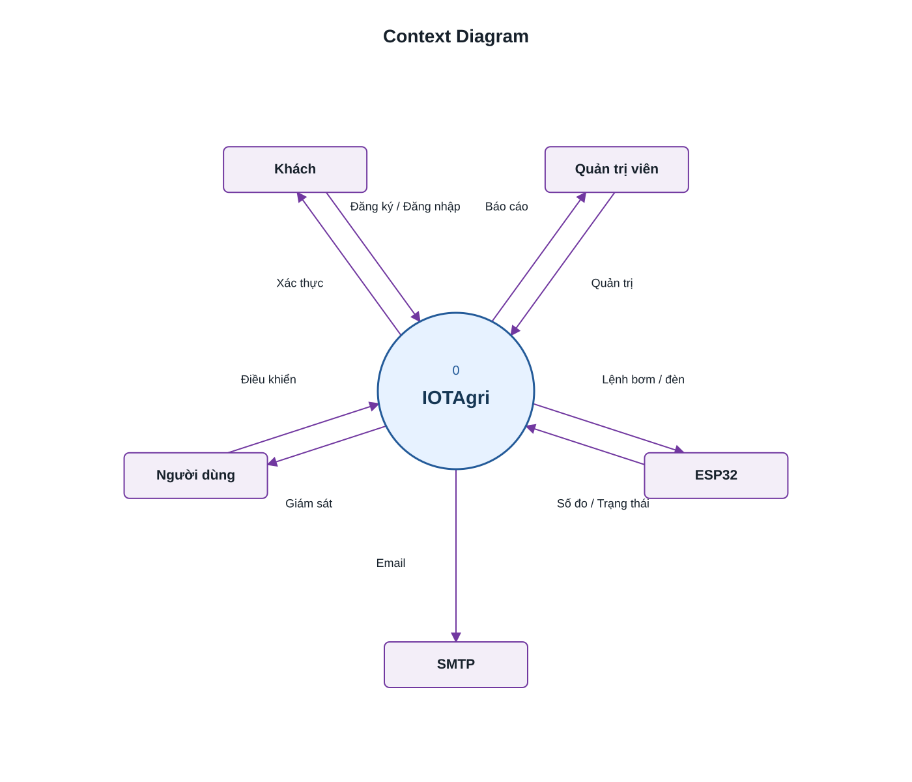

# Context Diagram — IOTAgri System Context

[← Thư viện sơ đồ](README.md) · [SRS](../requirements/SRS.md#2-bối-cảnh-và-tác-nhân) · [Use Case](../use-cases/README.md) · [Các sơ đồ](project-diagrams.md)

Context diagram biểu diễn IOTAgri như **một tiến trình duy nhất**, trao đổi dữ liệu với năm thực thể bên ngoài được phân bổ đều quanh vòng tròn trung tâm. Mũi tên chỉ hướng dữ liệu; nhãn rút gọn để dễ đọc, chi tiết nằm trong bảng luồng dữ liệu bên dưới. Nội dung bám theo baseline **27/10/2026** của [SRS](../requirements/SRS.md) và [nguồn đối chiếu](../reference/source-baseline.md).



[Mở ảnh SVG](rendered/context-diagram-radial.svg) · [Nguồn Mermaid](system-context.mmd)

## Ranh giới hệ thống

IOTAgri bao gồm ứng dụng Flutter, backend ASP.NET Core, xử lý lịch/cảnh báo, cơ sở dữ liệu PostgreSQL và hạ tầng MQTT/Mosquitto thuộc hệ thống. Những thành phần này không tách thành thực thể bên ngoài trong context diagram. ESP32 là thiết bị bên ngoài trao đổi với IOTAgri; SMTP là dịch vụ chuyển email tích hợp bên ngoài.

Ở mức bối cảnh, đường nối với ESP32 gộp hai kênh: ghép nối qua HTTP API và trao đổi số đo/lệnh/trạng thái qua MQTT. Xem [luồng kết nối kỹ thuật trong SRS](../requirements/SRS.md#22-luồng-kết-nối-kỹ-thuật) nếu cần biết các thành phần trung gian.

## Luồng dữ liệu

| Thực thể bên ngoài | Dữ liệu gửi vào IOTAgri | Dữ liệu IOTAgri gửi ra |
| --- | --- | --- |
| Khách | Thông tin đăng ký/đăng nhập; yêu cầu khôi phục và dữ liệu đặt lại mật khẩu | Kết quả xác thực, phiên đăng nhập và kết quả xử lý yêu cầu mật khẩu |
| Người dùng đã đăng nhập | Yêu cầu quản lý thiết bị, giám sát; lệnh bơm/đèn; lịch, ngưỡng và phiếu hỗ trợ | Số đo, lịch sử, trạng thái thiết bị; kết quả lệnh, cảnh báo và phản hồi hỗ trợ |
| Quản trị viên | Yêu cầu quản trị tài khoản/thiết bị; cấu hình, truy vấn báo cáo và xử lý hỗ trợ | Dữ liệu quản trị, báo cáo/CSV, nhật ký, trạng thái và kết quả xử lý |
| Thiết bị ESP32 | Mã ghép nối, hardwareId; số đo cảm biến, ACK và trạng thái bơm/đèn | DeviceKey, cấu hình/thông tin xác thực MQTT và lệnh điều khiển bơm/đèn |
| Dịch vụ email SMTP | Không biểu diễn luồng nghiệp vụ đầu vào từ SMTP | Yêu cầu gửi thư, địa chỉ người nhận và liên kết đặt lại mật khẩu |

SMTP chuyển thư tới hộp thư người nhận theo cấu hình; sơ đồ không giả định có callback xác nhận phát thư. Cảnh báo ở đây là dữ liệu người dùng xem trong hệ thống, không hàm ý đã có dịch vụ push notification cloud. Lệnh đã gửi không đồng nghĩa relay đã thực thi; ACK/trạng thái thiết bị là luồng phản hồi riêng.

## Cập nhật sơ đồ

Chỉnh [system-context.mmd](system-context.mmd), sau đó render lại SVG từ gốc repository:

```sh
python docs/diagrams/render-context.py
```

Script dùng thư viện chuẩn Python, đọc tên thực thể và nhãn luồng từ nguồn Mermaid, cố định năm thực thể cách nhau 72° quanh vòng tròn. Render trực tiếp bằng Mermaid có thể cho bố cục khác.

Context diagram thể hiện ranh giới và luồng dữ liệu; [Use Case](../use-cases/README.md) thể hiện mục tiêu của actor, còn [ERD](../data/README.md) mô tả cấu trúc dữ liệu.
