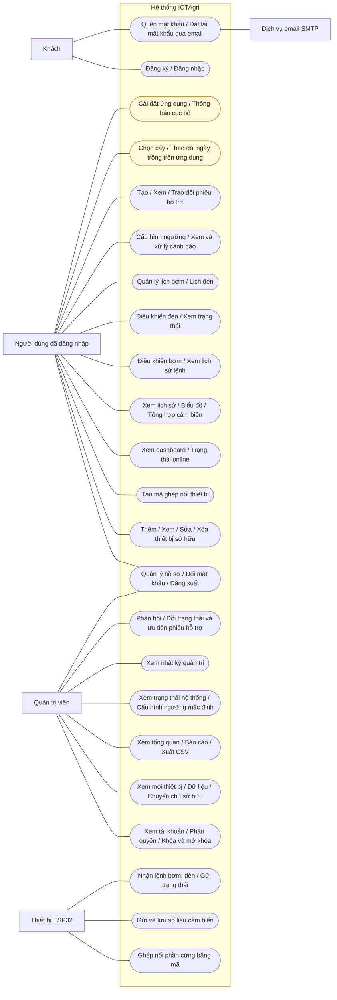

# IOTAgri — Use Case và ERD

[← Thư viện](README.md) · [SRS](../requirements/SRS.md) · [Luồng Use Case](../use-cases/README.md) · [Từ điển dữ liệu](../data/README.md)

Đối chiếu source ngày 27/10/2026. Trang này nhúng nguyên nội dung hai tệp Mermaid chuẩn; giải thích và giới hạn nằm trong các liên kết trên.

## Use Case

## ERD

```mermaid
erDiagram
    direction LR
    AspNetUsers |o--o{ Devices : "OwnerId (nullable)"
    AspNetUsers ||--o{ RefreshTokens : UserId
    AspNetUsers ||--o{ AspNetUserRoles : UserId
    AspNetRoles ||--o{ AspNetUserRoles : RoleId
    AspNetUsers ||--o{ AspNetUserClaims : UserId
    AspNetUsers ||--o{ AspNetUserLogins : UserId
    AspNetUsers ||--o{ AspNetUserTokens : UserId
    AspNetRoles ||--o{ AspNetRoleClaims : RoleId
    Devices ||--o{ SensorReadings : DeviceId
    Devices ||--o{ PumpCommands : DeviceId
    Devices ||--o{ PumpSchedules : DeviceId
    Devices ||--o{ LightSchedules : DeviceId
    Devices ||--o{ DeviceAlerts : DeviceId
    PumpSchedules ||--o{ PumpScheduleOccurrences : ScheduleId
    AspNetUsers ||--o{ SupportTickets : UserId
    SupportTickets ||--o{ SupportTicketMessages : TicketId
    AspNetUsers ||--o{ SupportTicketMessages : AuthorUserId

    AspNetUsers {
        string Id PK
        string Email "nullable trong Identity"
        string UserName "nullable trong Identity"
        string FullName
        string PhoneNumber "nullable"
        string PasswordHash "nullable trong Identity"
        bool LockoutEnabled
        datetimeoffset LockoutEnd "nullable"
    }
    AspNetRoles {
        string Id PK
        string Name "User / Admin"
        string NormalizedName UK
    }
    AspNetUserRoles {
        string UserId PK,FK
        string RoleId PK,FK
    }
    AspNetUserClaims {
        int Id PK
        string UserId FK
        string ClaimType
        string ClaimValue
    }
    AspNetUserLogins {
        string LoginProvider PK
        string ProviderKey PK
        string UserId FK
        string ProviderDisplayName
    }
    AspNetUserTokens {
        string UserId PK,FK
        string LoginProvider PK
        string Name PK
        string Value
    }
    AspNetRoleClaims {
        int Id PK
        string RoleId FK
        string ClaimType
        string ClaimValue
    }
    RefreshTokens {
        uuid Id PK
        string UserId FK
        string Token UK
        datetime CreatedAt
        datetime ExpiresAt
        datetime RevokedAt "nullable"
        string ReplacedByToken "nullable; khong phai FK"
    }
    Devices {
        uuid Id PK
        string OwnerId FK "nullable"
        string Name
        string DeviceKey UK
        datetime CreatedAt
        bool IsOnline
        datetime LastSeenAt "nullable"
        bool IsPumpOn
        datetime PumpStatusUpdatedAt "nullable"
        double HighTemperatureAlertC "nullable"
        double LowWaterLevelAlertPercent "nullable"
        string ProvisioningCodeHash "nullable"
        datetime ProvisioningCodeExpiresAt "nullable"
        string ProvisionedHardwareId UK "nullable"
        datetime ProvisionedAt "nullable"
        uuid ProvisioningClaimLeaseId "nullable"
        datetime ProvisioningClaimLeaseExpiresAt "nullable"
    }
    SensorReadings {
        uuid Id PK
        uuid DeviceId FK
        double Temperature "nullable"
        double SolutionTemperature "nullable"
        double Humidity "nullable"
        double Ph "nullable"
        double Tds "nullable"
        double WaterLevel "nullable"
        double Lux "nullable"
        datetime RecordedAt
    }
    PumpCommands {
        uuid Id PK
        uuid DeviceId FK
        bool IsOn
        int DurationSeconds "nullable"
        int Source "Manual / Scheduled"
        int Status "Pending / Acknowledged / Failed"
        datetime IssuedAt
        datetime AcknowledgedAt "nullable"
        bool AcknowledgedIsOn "nullable"
        string FailureReason "nullable"
    }
    PumpSchedules {
        uuid Id PK
        uuid DeviceId FK
        bool IsEnabled
        int WeekdayMask
        time StartTime
        time EndTime "nullable"
        int IntervalMinutes "nullable"
        date ActiveFromDate "nullable"
        date ActiveUntilDate "nullable"
        int DurationSeconds
        string TimeZone
        datetime LastDispatchedOccurrenceUtc "nullable"
        datetime CreatedAt
    }
    PumpScheduleOccurrences {
        uuid Id PK
        uuid ScheduleId FK
        uuid CommandId UK "tham chieu logic; khong phai FK"
        datetime OccurrenceUtc
        datetime DispatchedAt "nullable"
    }
    LightSchedules {
        uuid Id PK
        uuid DeviceId FK
        bool IsEnabled
        int WeekdayMask
        time StartTime
        int DurationSeconds
        string TimeZone
        datetime LastDispatchedOccurrenceUtc "nullable"
        datetime LastTurnedOffOccurrenceUtc "nullable"
        datetime CreatedAt
    }
    DeviceAlerts {
        uuid Id PK
        uuid DeviceId FK
        int Type "HighTemperature / LowWaterLevel"
        double MeasuredValue
        double Threshold
        datetime TriggeredAt
        datetime ResolvedAt "nullable"
    }
    SupportTickets {
        uuid Id PK
        string UserId FK
        string Subject
        string Category
        uuid DeviceId "nullable; khong phai FK"
        string DeviceName "nullable"
        string Status
        string Priority
        datetime CreatedAt
        datetime UpdatedAt
    }
    SupportTicketMessages {
        uuid Id PK
        uuid TicketId FK
        string AuthorUserId FK
        string Body
        datetime CreatedAt
    }
    AdminAuditLogs {
        uuid Id PK
        string ActorUserId "khong phai FK"
        string Action
        string TargetType
        string TargetId "khong phai FK"
        string PreviousValue "nullable"
        string NewValue "nullable"
        datetime CreatedAt
    }
    SystemAlertDefaults {
        int Id PK "singleton; Id = 1"
        double HighTemperatureC
        double LowWaterLevelPercent
        datetime UpdatedAt
    }
```

