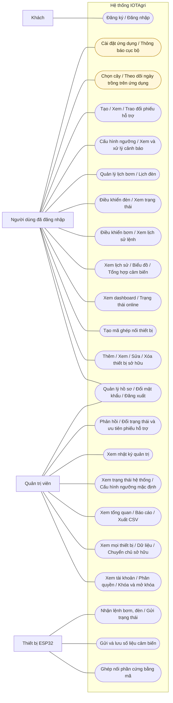

# IOTAgri ? Use Case v? ERD

## Use Case

## ERD

```mermaid
erDiagram
    direction LR
    AspNetUsers |o--o{ Devices : "OwnerId (nullable)"
    AspNetUsers ||--o{ RefreshTokens : UserId
    AspNetUsers ||--o{ AspNetUserRoles : UserId
    AspNetRoles ||--o{ AspNetUserRoles : RoleId
    AspNetUsers ||--o{ AspNetUserClaims : UserId
    AspNetUsers ||--o{ AspNetUserLogins : UserId
    AspNetUsers ||--o{ AspNetUserTokens : UserId
    AspNetRoles ||--o{ AspNetRoleClaims : RoleId
    Devices ||--o{ SensorReadings : DeviceId
    Devices ||--o{ PumpCommands : DeviceId
    Devices ||--o{ PumpSchedules : DeviceId
    Devices ||--o{ LightSchedules : DeviceId
    Devices ||--o{ DeviceAlerts : DeviceId
    PumpSchedules ||--o{ PumpScheduleOccurrences : ScheduleId
    AspNetUsers ||--o{ SupportTickets : UserId
    SupportTickets ||--o{ SupportTicketMessages : TicketId
    AspNetUsers ||--o{ SupportTicketMessages : AuthorUserId

    AspNetUsers {
        string Id PK
        string Email
        string UserName
        string FullName
        string PasswordHash
        bool LockoutEnabled
        datetimeoffset LockoutEnd "nullable"
    }
    AspNetRoles {
        string Id PK
        string Name "User / Admin"
        string NormalizedName UK
    }
    AspNetUserRoles {
        string UserId PK,FK
        string RoleId PK,FK
    }
    AspNetUserClaims {
        int Id PK
        string UserId FK
        string ClaimType
        string ClaimValue
    }
    AspNetUserLogins {
        string LoginProvider PK
        string ProviderKey PK
        string UserId FK
        string ProviderDisplayName
    }
    AspNetUserTokens {
        string UserId PK,FK
        string LoginProvider PK
        string Name PK
        string Value
    }
    AspNetRoleClaims {
        int Id PK
        string RoleId FK
        string ClaimType
        string ClaimValue
    }
    RefreshTokens {
        uuid Id PK
        string UserId FK
        string Token UK
        datetime CreatedAt
        datetime ExpiresAt
        datetime RevokedAt "nullable"
        string ReplacedByToken "nullable; khong phai FK"
    }
    Devices {
        uuid Id PK
        string OwnerId FK "nullable"
        string Name
        string DeviceKey UK
        datetime CreatedAt
        bool IsOnline
        datetime LastSeenAt "nullable"
        bool IsPumpOn
        datetime PumpStatusUpdatedAt "nullable"
        double HighTemperatureAlertC "nullable"
        double LowWaterLevelAlertPercent "nullable"
        string ProvisioningCodeHash "nullable"
        datetime ProvisioningCodeExpiresAt "nullable"
        string ProvisionedHardwareId UK "nullable"
        datetime ProvisionedAt "nullable"
        uuid ProvisioningClaimLeaseId "nullable"
        datetime ProvisioningClaimLeaseExpiresAt "nullable"
    }
    SensorReadings {
        uuid Id PK
        uuid DeviceId FK
        double Temperature "nullable"
        double SolutionTemperature "nullable"
        double Humidity "nullable"
        double Ph "nullable"
        double Tds "nullable"
        double WaterLevel "nullable"
        double Lux "nullable"
        datetime RecordedAt
    }
    PumpCommands {
        uuid Id PK
        uuid DeviceId FK
        bool IsOn
        int DurationSeconds "nullable"
        int Source "Manual / Scheduled"
        int Status "Pending / Acknowledged / Failed"
        datetime IssuedAt
        datetime AcknowledgedAt "nullable"
        bool AcknowledgedIsOn "nullable"
        string FailureReason "nullable"
    }
    PumpSchedules {
        uuid Id PK
        uuid DeviceId FK
        bool IsEnabled
        int WeekdayMask
        time StartTime
        time EndTime "nullable"
        int IntervalMinutes "nullable"
        date ActiveFromDate "nullable"
        date ActiveUntilDate "nullable"
        int DurationSeconds
        string TimeZone
        datetime LastDispatchedOccurrenceUtc "nullable"
        datetime CreatedAt
    }
    PumpScheduleOccurrences {
        uuid Id PK
        uuid ScheduleId FK
        uuid CommandId UK "tham chieu logic; khong phai FK"
        datetime OccurrenceUtc
        datetime DispatchedAt "nullable"
    }
    LightSchedules {
        uuid Id PK
        uuid DeviceId FK
        bool IsEnabled
        int WeekdayMask
        time StartTime
        int DurationSeconds
        string TimeZone
        datetime LastDispatchedOccurrenceUtc "nullable"
        datetime LastTurnedOffOccurrenceUtc "nullable"
        datetime CreatedAt
    }
    DeviceAlerts {
        uuid Id PK
        uuid DeviceId FK
        int Type "HighTemperature / LowWaterLevel"
        double MeasuredValue
        double Threshold
        datetime TriggeredAt
        datetime ResolvedAt "nullable"
    }
    SupportTickets {
        uuid Id PK
        string UserId FK
        string Subject
        string Category
        uuid DeviceId "nullable; khong phai FK"
        string DeviceName "nullable"
        string Status
        string Priority
        datetime CreatedAt
        datetime UpdatedAt
    }
    SupportTicketMessages {
        uuid Id PK
        uuid TicketId FK
        string AuthorUserId FK
        string Body
        datetime CreatedAt
    }
    AdminAuditLogs {
        uuid Id PK
        string ActorUserId "khong phai FK"
        string Action
        string TargetType
        string TargetId "khong phai FK"
        string PreviousValue "nullable"
        string NewValue "nullable"
        datetime CreatedAt
    }
    SystemAlertDefaults {
        int Id PK "singleton; Id = 1"
        double HighTemperatureC
        double LowWaterLevelPercent
        datetime UpdatedAt
    }
```

# Use Case và ERD — IOTAgri

Sơ đồ mô tả mã nguồn trong workspace tại ngày 24/10/2026, không phải schema đọc từ database đang chạy. Nguồn xác minh chính: các endpoint, model, cấu hình EF Core và migration snapshot hiện tại.

## Các tệp

- [Sơ đồ và giải thích đầy đủ](./project-diagrams.md): xem trong trình đọc Markdown hỗ trợ Mermaid.
- [Use Case — Mermaid](./use-case.mmd): bản trực quan với actor dạng khối, use case dạng ellipse; đây là cách biểu diễn gần đúng vì Mermaid chưa có cú pháp UML Use Case riêng.
- [Use Case — PlantUML](./use-case.puml): bản UML có actor, use case và ranh giới hệ thống.
- [ERD — Mermaid](./erd.mmd): các bảng, trường chính, khóa và quan hệ thực sự cấu hình trong EF Core.

## Phạm vi và cách đọc

Use Case nhóm các thao tác cùng mục tiêu để sơ đồ dễ đọc; những nhóm CRUD có thể tách thành từng use case khi viết đặc tả chi tiết. Đăng nhập là tiền điều kiện của API nghiệp vụ; không vẽ `include` đến đăng nhập vì mỗi thao tác không thực hiện đăng nhập lại. Scheduler là thành phần nội bộ, không phải actor bên ngoài hệ thống. MQTT là kênh giao tiếp với ESP32.

Vai trò hiện có là `User` và `Admin`. API người dùng yêu cầu xác thực và thường kiểm tra thiết bị thuộc `OwnerId` của người gọi; quyền Admin không tự bỏ qua kiểm tra sở hữu ở API này. API quản trị dùng chính sách `AdminOnly`. Admin vẫn có thể dùng API người dùng trên dữ liệu thuộc tài khoản của mình. Sơ đồ gom các quyền quản trị ở actor Admin cho dễ đọc, không mô tả kế thừa vai trò.

Chọn cây và ngày bắt đầu trồng có trong Flutter: danh mục dùng `mock_data.dart`, lựa chọn đang trồng lưu bằng `SharedPreferences`. Cài đặt ứng dụng/thông báo cũng có dữ liệu cục bộ. Lịch sử thu hoạch trong `harvest_screen.dart` dùng `mockHarvests`. Chưa có bảng PostgreSQL cho cây trồng, vụ trồng, thu hoạch hay thông báo đẩy; do đó không thêm các bảng này vào ERD. Lịch sử thu hoạch mock không được đưa vào nhóm chức năng nghiệp vụ hoàn thiện.

ERD dùng tên bảng thực tế: `ApplicationUser` tương ứng `AspNetUsers`. Các bảng Identity phụ được thể hiện để thấy cấu trúc xác thực/phân quyền, nhưng danh sách thuộc tính của Identity đã được rút gọn. `PK` là khóa chính, `FK` là khóa ngoại có khai báo, `UK` là khóa duy nhất; các thành phần cùng đánh dấu PK tạo khóa chính ghép. `uuid`, `datetime`, `time`, `date` là kiểu trình bày khái quát; `datetime` của nghiệp vụ tương ứng `DateTime` trong model, được PostgreSQL lưu theo mapping EF Core. Nullable được ghi trong chú thích trường.

## Những quan hệ cần phân biệt

| Trường | Hiện trạng |
| --- | --- |
| `Devices.OwnerId` | FK nullable đến `AspNetUsers`; một thiết bị có 0 hoặc 1 chủ sở hữu. Xóa user đặt OwnerId về null. |
| `PumpScheduleOccurrences.ScheduleId` | FK đến lịch bơm, xóa lịch kéo theo các lần chạy. |
| `PumpScheduleOccurrences.CommandId` | Có unique index, được dùng để liên kết logic với lệnh bơm; chưa khai báo FK đến `PumpCommands`. |
| `SupportTickets.DeviceId` | Nullable, có index; chưa khai báo FK đến `Devices`. |
| `AdminAuditLogs.ActorUserId` | Lưu mã người thao tác; chưa khai báo FK đến `AspNetUsers`. |
| `AdminAuditLogs.TargetId` | Mã đối tượng tùy theo TargetType; không phải FK đa hình trong database. |
| `RefreshTokens.ReplacedByToken` | Chuỗi token thay thế, chưa có FK tự tham chiếu. |
| `SystemAlertDefaults` | Bảng cấu hình độc lập, singleton với `Id = 1`; không có FK đến thiết bị. |

Các tham chiếu logic chưa có FK được ghi trong trường/chú thích, không vẽ thành đường quan hệ vật lý. Không có bảng `LightCommands` hoặc `LightStatus`: lệnh đèn được gửi qua MQTT, trạng thái đèn hiện được giữ trong bộ nhớ của `MqttIngestionService`.

## Ràng buộc đáng chú ý

- `Devices.DeviceKey`, `Devices.ProvisionedHardwareId` và `RefreshTokens.Token` có unique index. Hardware ID cho phép null.
- `(PumpScheduleOccurrences.ScheduleId, OccurrenceUtc)` duy nhất; `CommandId` cũng duy nhất.
- `(DeviceAlerts.DeviceId, Type)` chỉ duy nhất khi `ResolvedAt IS NULL`: mỗi thiết bị tối đa một cảnh báo đang hoạt động cho mỗi loại.
- `PumpSchedules` và `LightSchedules`: `WeekdayMask` từ 1 đến 127, `DurationSeconds > 0`.
- `PumpCommands.DurationSeconds` được phép null, nếu có phải lớn hơn 0.
- `SystemAlertDefaults.LowWaterLevelPercent` nằm trong khoảng 0–100.
- Xóa thiết bị cascade dữ liệu cảm biến, lệnh bơm, lịch bơm/đèn và cảnh báo. FK của ticket tới user và tin nhắn tới tác giả dùng Restrict; xóa ticket cascade tin nhắn.
- Tự chạy lịch bơm/đèn phụ thuộc cấu hình `PumpScheduling:Enabled` và `LightScheduling:Enabled`.

## Mã nguồn đối chiếu

- [ApplicationDbContext](../../backend/Data/ApplicationDbContext.cs): DbSet, FK, index, check constraint và hành vi xóa.
- [Migration snapshot](../../backend/Migrations/ApplicationDbContextModelSnapshot.cs): tên bảng và mô hình database hiện tại trong repository.
- [Models](../../backend/Models): thuộc tính thực thể.
- [AuthEndpoints](../../backend/Endpoints/AuthEndpoints.cs), [DeviceEndpoints](../../backend/Endpoints/DeviceEndpoints.cs), [DeviceProvisioningEndpoints](../../backend/Endpoints/DeviceProvisioningEndpoints.cs).
- [SensorEndpoints](../../backend/Endpoints/SensorEndpoints.cs), [DashboardEndpoints](../../backend/Endpoints/DashboardEndpoints.cs).
- [AdminEndpoints](../../backend/Endpoints/AdminEndpoints.cs), [TicketEndpoints](../../backend/Endpoints/TicketEndpoints.cs), [RoleSeeder](../../backend/Data/RoleSeeder.cs).
- [MqttIngestionService](../../backend/Services/MqttIngestionService.cs), [PumpScheduleDispatchService](../../backend/Services/PumpScheduleDispatchService.cs), [LightScheduleDispatchService](../../backend/Services/LightScheduleDispatchService.cs).
- [Dữ liệu cây và lưu lựa chọn](../../frontend/lib/providers/data_providers.dart), [Danh mục mock](../../frontend/lib/data/mock_data.dart), [Lịch sử thu hoạch mock](../../frontend/lib/screens/harvest_screen.dart).

Đã kiểm tra sơ đồ với các khai báo model/DbSet và FK trong snapshot. Chưa render bằng Mermaid CLI/PlantUML tại môi trường này.
