# IOTAgri — Context Diagram, Use Case và ERD

[← Thư viện](README.md) · [SRS](../requirements/SRS.md) · [Luồng Use Case](../use-cases/README.md) · [Từ điển dữ liệu](../data/README.md)

Đối chiếu source ngày 27/10/2026. Trang này nhúng Context Diagram, ảnh UML Use Case và mã Mermaid ERD; giải thích và giới hạn nằm trong các liên kết trên.

## Context Diagram

IOTAgri là một tiến trình duy nhất trao đổi dữ liệu với năm thực thể bên ngoài. Xem [ranh giới và luồng dữ liệu](context-diagram.md) · [Nguồn Mermaid](system-context.mmd).

## Use Case

Tất cả actor cùng xuất hiện trong một sơ đồ, bên ngoài **một khung hệ thống IOTAgri duy nhất**. Tên actor nằm dưới hình người que. Các use case bố trí so le bên trong và nối trực tiếp với actor tương ứng. Use case dùng chung chỉ vẽ một lần, nhận liên kết từ các actor liên quan.

Nguồn: [PlantUML chi tiết](use-case.puml) · [Tổng quan](rendered/use-case-overview.svg). Màu vàng là chức năng cục bộ/mock.

## ERD

