# IOTAgri - Context Diagram, Use Case and ERD

[Diagram library](README.md) / [SRS](../requirements/SRS.md) / [Use Case flows](../use-cases/README.md) / [Data dictionary](../data/README.md)

Checked against the source baseline of 27 October 2026. This page embeds the Context Diagram, UML Use Case SVG and Mermaid ERD. Supporting explanations and limitations are available through the links above.

## Context Diagram

IOTAgri is represented as one process exchanging data with five external entities. See [system boundaries and data flows](context-diagram.md) and the [Mermaid source](system-context.mmd).

## Use Case

All actors appear together in one diagram, outside **a single shared IOTAgri system boundary**. Actor names are placed below the stick figures. Use cases are staggered inside the boundary and connected directly to their actors. A shared use case is drawn once and linked to every relevant actor.

Sources: [Detailed PlantUML](use-case.puml) / [Overview](rendered/use-case-overview.svg). Yellow indicates local/mock functionality.

## ERD

```mermaid
erDiagram
    direction LR
    AspNetUsers |o--o{ Devices : "OwnerId (nullable)"
    AspNetUsers ||--o{ RefreshTokens : UserId
    AspNetUsers ||--o{ AspNetUserRoles : UserId
    AspNetRoles ||--o{ AspNetUserRoles : RoleId
    AspNetUsers ||--o{ AspNetUserClaims : UserId
    AspNetUsers ||--o{ AspNetUserLogins : UserId
    AspNetUsers ||--o{ AspNetUserTokens : UserId
    AspNetRoles ||--o{ AspNetRoleClaims : RoleId
    Devices ||--o{ SensorReadings : DeviceId
    Devices ||--o{ PumpCommands : DeviceId
    Devices ||--o{ PumpSchedules : DeviceId
    Devices ||--o{ LightSchedules : DeviceId
    Devices ||--o{ DeviceAlerts : DeviceId
    PumpSchedules ||--o{ PumpScheduleOccurrences : ScheduleId
    AspNetUsers ||--o{ SupportTickets : UserId
    SupportTickets ||--o{ SupportTicketMessages : TicketId
    AspNetUsers ||--o{ SupportTicketMessages : AuthorUserId

    AspNetUsers {
        string Id PK
        string Email "nullable in Identity"
        string UserName "nullable in Identity"
        string FullName
        string PhoneNumber "nullable"
        string PasswordHash "nullable in Identity"
        bool LockoutEnabled
        datetimeoffset LockoutEnd "nullable"
    }
    AspNetRoles {
        string Id PK
        string Name "User / Admin"
        string NormalizedName UK
    }
    AspNetUserRoles {
        string UserId PK,FK
        string RoleId PK,FK
    }
    AspNetUserClaims {
        int Id PK
        string UserId FK
        string ClaimType
        string ClaimValue
    }
    AspNetUserLogins {
        string LoginProvider PK
        string ProviderKey PK
        string UserId FK
        string ProviderDisplayName
    }
    AspNetUserTokens {
        string UserId PK,FK
        string LoginProvider PK
        string Name PK
        string Value
    }
    AspNetRoleClaims {
        int Id PK
        string RoleId FK
        string ClaimType
        string ClaimValue
    }
    RefreshTokens {
        uuid Id PK
        string UserId FK
        string Token UK
        datetime CreatedAt
        datetime ExpiresAt
        datetime RevokedAt "nullable"
        string ReplacedByToken "nullable; not an FK"
    }
    Devices {
        uuid Id PK
        string OwnerId FK "nullable"
        string Name
        string DeviceKey UK
        datetime CreatedAt
        bool IsOnline
        datetime LastSeenAt "nullable"
        bool IsPumpOn
        datetime PumpStatusUpdatedAt "nullable"
        double HighTemperatureAlertC "nullable"
        double LowWaterLevelAlertPercent "nullable"
        string ProvisioningCodeHash "nullable"
        datetime ProvisioningCodeExpiresAt "nullable"
        string ProvisionedHardwareId UK "nullable"
        datetime ProvisionedAt "nullable"
        uuid ProvisioningClaimLeaseId "nullable"
        datetime ProvisioningClaimLeaseExpiresAt "nullable"
    }
    SensorReadings {
        uuid Id PK
        uuid DeviceId FK
        double Temperature "nullable"
        double SolutionTemperature "nullable"
        double Humidity "nullable"
        double Ph "nullable"
        double Tds "nullable"
        double WaterLevel "nullable"
        double Lux "nullable"
        datetime RecordedAt
    }
    PumpCommands {
        uuid Id PK
        uuid DeviceId FK
        bool IsOn
        int DurationSeconds "nullable"
        int Source "Manual / Scheduled"
        int Status "Pending / Acknowledged / Failed"
        datetime IssuedAt
        datetime AcknowledgedAt "nullable"
        bool AcknowledgedIsOn "nullable"
        string FailureReason "nullable"
    }
    PumpSchedules {
        uuid Id PK
        uuid DeviceId FK
        bool IsEnabled
        int WeekdayMask
        time StartTime
        time EndTime "nullable"
        int IntervalMinutes "nullable"
        date ActiveFromDate "nullable"
        date ActiveUntilDate "nullable"
        int DurationSeconds
        string TimeZone
        datetime LastDispatchedOccurrenceUtc "nullable"
        datetime CreatedAt
    }
    PumpScheduleOccurrences {
        uuid Id PK
        uuid ScheduleId FK
        uuid CommandId UK "logical reference; not an FK"
        datetime OccurrenceUtc
        datetime DispatchedAt "nullable"
    }
    LightSchedules {
        uuid Id PK
        uuid DeviceId FK
        bool IsEnabled
        int WeekdayMask
        time StartTime
        int DurationSeconds
        string TimeZone
        datetime LastDispatchedOccurrenceUtc "nullable"
        datetime LastTurnedOffOccurrenceUtc "nullable"
        datetime CreatedAt
    }
    DeviceAlerts {
        uuid Id PK
        uuid DeviceId FK
        int Type "HighTemperature / LowWaterLevel"
        double MeasuredValue
        double Threshold
        datetime TriggeredAt
        datetime ResolvedAt "nullable"
    }
    SupportTickets {
        uuid Id PK
        string UserId FK
        string Subject
        string Category
        uuid DeviceId "nullable; not an FK"
        string DeviceName "nullable"
        string Status
        string Priority
        datetime CreatedAt
        datetime UpdatedAt
    }
    SupportTicketMessages {
        uuid Id PK
        uuid TicketId FK
        string AuthorUserId FK
        string Body
        datetime CreatedAt
    }
    AdminAuditLogs {
        uuid Id PK
        string ActorUserId "not an FK"
        string Action
        string TargetType
        string TargetId "not an FK"
        string PreviousValue "nullable"
        string NewValue "nullable"
        datetime CreatedAt
    }
    SystemAlertDefaults {
        int Id PK "singleton; Id = 1"
        double HighTemperatureC
        double LowWaterLevelPercent
        datetime UpdatedAt
    }
```

