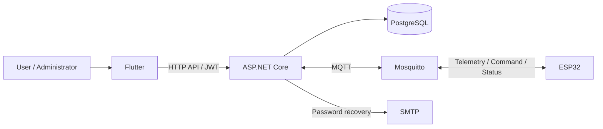

# SRS — Đặc tả yêu cầu phần mềm IOTAgri

[← Mục lục](../README.md) · [Use Case](../use-cases/README.md) · [ERD](../data/README.md)

| Thuộc tính | Giá trị |
| --- | --- |
| Phiên bản tài liệu | 1.0 — mô tả hiện trạng source |
| Ngày đối chiếu | 27/10/2026 |
| Hệ thống | IOTAgri / Aerogreen — giám sát và điều khiển nông nghiệp thủy canh |
| Baseline | [Commit, tệp nguồn và giới hạn workspace](../reference/source-baseline.md) |
| Trạng thái | Suy ra từ source; chưa phải bản yêu cầu đã được các bên ký duyệt |

## 1. Mục đích và phạm vi

Hệ thống cho phép người dùng quản lý thiết bị ESP32, quan sát số đo, gửi lệnh bơm/đèn, thiết lập lịch, nhận cảnh báo và trao đổi hỗ trợ. Quản trị viên quản lý tài khoản, thiết bị toàn hệ thống, báo cáo và cấu hình chung.

Tài liệu mô tả các hành vi đã thấy trong Flutter, ASP.NET Core Minimal API, EF Core/PostgreSQL, dịch vụ MQTT và firmware. Không suy diễn bảng dữ liệu từ giao diện. Chưa có backend quản lý vụ trồng/thu hoạch, thông báo đẩy cloud hoặc giao thức đồng bộ toàn bộ lịch xuống ESP32 để chạy tự trị khi mất mạng.

## 2. Bối cảnh và tác nhân

| Tác nhân | Mục tiêu và quyền |
| --- | --- |
| Khách | Đăng ký, đăng nhập, yêu cầu email và đặt lại mật khẩu |
| Người dùng đã xác thực | Hồ sơ, thiết bị thuộc sở hữu, giám sát, điều khiển, lịch, cảnh báo và ticket cá nhân |
| Quản trị viên | Các API `/api/admin` có chính sách `AdminOnly` |
| ESP32 | Claim bằng mã thiết lập, gửi telemetry, nhận lệnh và gửi trạng thái qua MQTT |
| Dịch vụ SMTP | Chuyển email khôi phục mật khẩu theo cấu hình |

Admin có thể dùng API người dùng cho dữ liệu của chính mình. Quyền Admin không tự bỏ qua điều kiện `OwnerId` trong API chủ thiết bị. Scheduler, PostgreSQL và Mosquitto là thành phần nội bộ/hạ tầng, không coi scheduler là actor nghiệp vụ.

### 2.1 Context Diagram

IOTAgri được biểu diễn như một tiến trình duy nhất, trao đổi dữ liệu với Khách, Người dùng, Quản trị viên, ESP32 và SMTP. Flutter, backend, PostgreSQL và Mosquitto nằm trong phạm vi hệ thống. Xem [ranh giới và đặc tả luồng dữ liệu](../diagrams/context-diagram.md).

### 2.2 Luồng kết nối kỹ thuật

Sơ đồ sau phân rã các thành phần bên trong IOTAgri để giải thích kết nối kỹ thuật:

## 3. Yêu cầu chức năng và nghiệm thu

Các tiêu chí sau là căn cứ nghiệm thu đề xuất từ hành vi source. Danh sách test tương ứng ở phần 8 là bằng chứng truy vết; lần cập nhật tài liệu này không chạy lại bộ test ứng dụng.

| ID / Use Case | Yêu cầu hiện có | Tiêu chí chấp nhận |
| --- | --- | --- |
| FR-01 / UC-01 | Đăng ký bằng email duy nhất, mật khẩu và họ tên; gán vai trò User; đăng nhập trả access/refresh token | Thiếu trường bị từ chối; email trùng trả 409; sai mật khẩu hoặc tài khoản bị khóa không được cấp token |
| FR-02 / UC-02 | Refresh token được kiểm tra, luân chuyển và thu hồi khi logout | Refresh token hết hạn/đã thu hồi trả 401; logout chỉ tác động token của người gọi; không khẳng định access JWT bị vô hiệu tức thì |
| FR-03 / UC-03 | Quên mật khẩu gửi liên kết email; reset bằng token Identity và thu hồi refresh token còn hiệu lực | Yêu cầu quên mật khẩu trả 202 cho cả email không tồn tại; token reset lỗi trả 400; thành công 204; quá giới hạn trả 429 |
| FR-04 / UC-04 | Xem/sửa họ tên, số điện thoại, đổi mật khẩu bằng mật khẩu hiện tại | Dữ liệu sai bị từ chối; thay số điện thoại hủy cờ xác minh; tùy chọn logoutOtherDevices thu hồi mọi refresh session vì chưa có ID phiên riêng |
| FR-05 / UC-05 | Tạo, xem danh sách/chi tiết, sửa và xóa thiết bị sở hữu | Truy cập thiết bị người khác trả 404; DeviceKey duy nhất; xóa phải thu hồi credentials broker trước, broker lỗi trả 503 và chưa xóa DB; thành công cascade theo ERD |
| FR-06 / UC-06 | Chủ thiết bị tạo mã ghép nối 15 phút; ESP32 claim một lần để nhận cấu hình và thông tin xác thực MQTT | Mã sai/hết hạn/đang claim bị từ chối; phần cứng đã gắn thiết bị khác trả 409; broker không sẵn sàng trả 503; có lease chống claim đồng thời |
| FR-07 / UC-07 | Nhận số đo qua `devices/{deviceKey}/readings`, lưu DB và cập nhật LastSeenAt | DeviceKey không tồn tại không tạo reading; đọc được 7 metric nullable; không chuyển giá trị thiếu thành 0 |
| FR-08 / UC-08 | Dashboard trả thiết bị, số đo mới nhất và online; đọc lịch sử và min/avg/max theo kỳ, median giờ/ngày | Dữ liệu bị giới hạn theo chủ; lịch sử mặc định 50, clamp 1–500; interval tổng hợp chỉ minute/hour/day/week/month; median dùng mốc UTC |
| FR-09 / UC-09 | Gửi lệnh bơm theo commandId, trạng thái, thời lượng; lưu lịch sử và ACK | Bật bơm cần telemetry và mực nước mới, đủ nước; từ chối trạng thái trùng, lịch đang giữ bơm và commandId xung đột; MQTT lỗi trả 503 và ghi Failed |
| FR-10 / UC-10 | CRUD lịch bơm theo thứ/giờ/IANA timezone, cửa sổ lặp và khoảng ngày tùy chọn | Duration hợp lệ; endTime đi cùng intervalMinutes; khoảng ngày đúng thứ tự; lịch bật chồng lấn bị từ chối; occurrence có khóa duy nhất |
| FR-11 / UC-11 | Gửi lệnh đèn và đọc trạng thái; CRUD lịch đèn | commandId rỗng trả 400; gửi được trả 202 Pending, không đồng nghĩa phần cứng đã bật; trạng thái ACK chỉ ở bộ nhớ backend; lịch lưu DB |
| FR-12 / UC-12 | Cấu hình ngưỡng riêng, đọc và resolve cảnh báo nhiệt độ cao/mức nước thấp | Ngưỡng riêng ưu tiên ngưỡng hệ thống; mỗi loại chỉ có tối đa một cảnh báo chưa resolve trên thiết bị; số đo bằng ngưỡng đã là unsafe |
| FR-13 / UC-13 | User tạo/xem/trả lời ticket của mình; Admin trả lời và đổi trạng thái/ưu tiên | Subject ≤200, category ≤64, message ≤4000 ký tự; ticket gắn thiết bị phải thuộc user; chuyển trạng thái theo quy tắc phần 4 |
| FR-14 / UC-14 | Admin xem tài khoản, đổi vai trò User/Admin, khóa/mở khóa | API yêu cầu AdminOnly; không đổi vai trò hoặc khóa chính mình; không hạ quyền/khóa admin cuối cùng; có audit thao tác quản trị |
| FR-15 / UC-15 | Admin xem mọi thiết bị, reading, lịch sử bơm và chuyển chủ | User thông thường bị chặn ở `/api/admin`; chuyển chủ thực hiện qua endpoint quản trị và được ghi audit |
| FR-16 / UC-16 | Admin xem overview, báo cáo tổng hợp/CSV, audit log, status và sửa ngưỡng mặc định | Chỉ Admin; ngưỡng mức nước trong 0–100; settings singleton Id=1 |
| FR-17 / UC-17 | Flutter chọn cây/ngày trồng và cài đặt/thông báo cục bộ | Lựa chọn cây lưu SharedPreferences; danh mục mock; không hứa đồng bộ đa thiết bị hoặc tạo bảng cây trong DB |
| FR-18 / UC-18 | Firmware nhận lệnh bơm/đèn, điều khiển relay, gửi ACK và bảo vệ bơm tại thiết bị | Có callback/subscription, timer và kiểm tra nước/clock trong source; nghiệm thu relay, cảm biến và thời điểm dừng phải làm trên phần cứng thật |

## 4. Quy tắc nghiệp vụ

| ID | Quy tắc và giới hạn |
| --- | --- |
| BR-01 | OwnerId nullable; owner API vẫn yêu cầu đúng chủ. Xóa user đặt owner về null ở FK, nhưng FK ticket/message dùng Restrict có thể ngăn xóa user |
| BR-02 | Thiết bị được coi offline nếu LastSeenAt null hoặc không mới hơn ngưỡng 30 giây; không chỉ dựa vào cờ IsOnline lưu DB |
| BR-03 | API bơm mặc định duration tối đa 600 giây và độ mới telemetry 30 giây, có thể cấu hình. Bật bơm cần reading mới với WaterLevel lớn hơn ngưỡng an toàn |
| BR-04 | Trong `[occurrenceUtc, occurrenceUtc + durationSeconds)`, lịch giữ quyền bơm; lệnh tay ON/OFF bị 409 `SCHEDULE_ACTIVE` nếu đi đến bước kiểm tra lịch. Các kiểm tra trước đó có thể trả mã lỗi khác |
| BR-05 | WeekdayMask: Chủ nhật=1 đến Thứ bảy=64, tổng hợp 1–127; timezone IANA, ví dụ Asia/Ho_Chi_Minh; lịch bơm lặp interval 1–60 phút, duration nhỏ hơn interval |
| BR-06 | Lịch chỉ tự chạy khi bật PumpScheduling:Enabled hoặc LightScheduling:Enabled; mặc định false. Poll mặc định 30 giây, cửa sổ đến hạn 90 giây; không có cam kết chạy chính xác tuyệt đối |
| BR-07 | Ngưỡng hiệu lực: thiết bị → singleton hệ thống → mặc định 35°C/20%. Nhiệt độ ≥ ngưỡng hoặc nước ≤ ngưỡng kích hoạt cảnh báo; metric null không được coi là đo an toàn |
| BR-08 | Ticket: open → in_progress → closed → open; priority low/medium/high. Các cặp chuyển trạng thái khác bị từ chối |
| BR-09 | Lệnh bơm có Pending/Acknowledged/Failed và Manual/Scheduled. Lệnh đèn không có bảng lịch sử tương đương; không suy diễn độ bền/idempotency của bơm cho đèn |
| BR-10 | Firmware hiện chỉ nhớ lệnh gần nhất theo từng actuator. Chưa chứng minh chống mọi chuỗi lệnh trễ, lịch chưa nhận hoặc replay qua reboot; backend và thiết bị không cùng một transaction |

## 5. Giao diện ngoài và dữ liệu

- **Flutter–API:** JSON qua HTTP; JWT bearer cho endpoint được bảo vệ. Danh sách method/path được trích từ khai báo endpoint ở [API inventory](../reference/api-inventory.md).
- **ESP32–API:** tạo claim bằng code và hardwareId, nhận DeviceKey, host/port, TLS và MQTT credentials. Endpoint claim không dùng JWT, được rate limit.
- **MQTT:** readings, commands/pump, pump-status, commands/light, light-status dưới `devices/{deviceKey}/`. Gửi thành công đến broker không phải xác nhận tác động relay.
- **Email:** SMTP theo PasswordResetOptions; liên kết `/reset-password?email=...&token=...`. Không có SMTP thì không thể coi email đã được chuyển đến người nhận.
- **Persistence:** 19 bảng trong snapshot (7 Identity, 12 nghiệp vụ). Xem [ERD](../data/README.md); không có bảng Plants/Harvests/LightCommands/Notifications.
- **Chỉ số:** Temperature và SolutionTemperature (°C), Humidity (%), Ph, Tds (ppm), WaterLevel (%), Lux (lx). Cả 7 trường có thể null; RecordedAt là thời điểm backend tạo bản ghi UTC.

## 6. Yêu cầu phi chức năng

| ID | Yêu cầu / bằng chứng hiện có | Giới hạn nghiệm thu |
| --- | --- | --- |
| NFR-01 Bảo mật truy cập | Identity hash mật khẩu; JWT xác minh issuer, audience, lifetime và signing key; policy AdminOnly, kiểm tra sở hữu | Chưa có cam kết access token bị hủy ngay khi đổi role/khóa/reset; cần xét thời hạn JWT |
| NFR-02 Khôi phục mật khẩu | Phản hồi chung tránh tiết lộ email; rate limit mặc định 5/15 phút/IP; SMTP SSL và HTTPS frontend bắt buộc trong Production | Test riêng token dùng lại/hết hạn, rate limit và SMTP lỗi; rate limiter trong bộ nhớ không phải quota chia sẻ toàn cụm |
| NFR-03 Bảo mật triển khai | CORS allowlist, forwarded headers; Data Protection key ring phải lưu bền ở Production; source có production compose, MQTT TLS và dynsec | Có cấu hình/source không chứng minh production đang chạy hoặc chứng chỉ/backup đã được kiểm thử |
| NFR-04 Toàn vẹn dữ liệu | FK, unique index, filtered index và check constraint theo EF; migration khi backend khởi động | Các tham chiếu logic không có FK phải được hiểu đúng; chưa có SLA retention hay phục hồi dữ liệu |
| NFR-05 Độ tin cậy điều khiển | Lịch bơm có occurrence bền, kiểm tra expiry; ACK cập nhật lệnh; firmware có fail-safe và timer | Không cam kết exactly-once vật lý, thời gian thực cứng hoặc chạy lịch offline khi chưa nhận lệnh |
| NFR-06 Hiệu năng | Index theo thiết bị/thời gian; API có giới hạn đọc và phân trang từng nhóm; Flutter dashboard polling 10 giây trong workspace | Chưa có kết quả load test hoặc ngưỡng p95/đồng thời được phê duyệt; 10 giây là polling client, không phải SLA end-to-end |
| NFR-07 Khả năng sử dụng | Flutter có bản dịch tiếng Việt/Anh và màn hình giám sát/quản trị | Chưa xác nhận kiểm thử accessibility, mọi nền tảng hoặc tính đồng nhất giữa mọi giao diện |
| NFR-08 Vận hành | `/health` kiểm tra kết nối DB, trả ready hoặc 503; OpenAPI/Swagger trong Development | Health không chứng minh MQTT, SMTP, ESP32 và relay đều khỏe |

## 7. Giới hạn, khác biệt và vấn đề cần quyết định

| Vấn đề | Hiện trạng / việc cần làm |
| --- | --- |
| Vụ trồng/thu hoạch | Danh mục cây và lịch sử harvest còn mock; lựa chọn đang trồng cục bộ. Cần thiết kế nghiệp vụ/schema riêng nếu muốn đồng bộ |
| Dashboard hiện tại | Workspace có thay đổi chưa commit về thiết bị đang chọn và đồng bộ dashboard. Ghi nhận ở baseline; không coi các thay đổi này đã có trên remote |
| Provider cảm biến cũ | PlantRepository còn gọi `/api/sensor/latest`, không thấy mapping backend; provider cũ có fallback mock. Không dùng đường này làm bằng chứng cho telemetry thật |
| Ưu tiên lịch tại phần cứng | Firmware đã có xử lý command, relay và mốc dừng, nhưng chưa có đồng bộ lịch sắp tới và bảo đảm từ chối mọi manual packet trễ trong cửa sổ lịch |
| Tài liệu triển khai cũ trên main | README phần planned và tài liệu pump-priority có mô tả cũ; source hiện đã có TLS/dynsec/relay. Bản Docs này ghi theo source, không sửa source/main |
| Chỉ tiêu vận hành | SLA, dung lượng/retention, RPO/RTO, quy mô thiết bị, tải đồng thời và ma trận phần cứng chưa được chốt; không tự đặt số đạt chuẩn |
| Push notification | Chưa có bằng chứng dịch vụ thông báo đẩy cloud hoàn chỉnh trong backend; thông báo cục bộ không thay thế kênh cloud |

## 8. Truy vết và kiểm chứng

| FR | Nguồn chính | Test có trong source (chưa chạy lại trong đợt tài liệu) |
| --- | --- | --- |
| 01–04 | AuthEndpoints, Program, TokenService, PasswordResetNotificationSender | AuthHandlerTests, ProfileRulesTests, PasswordResetSecurityTests, PasswordResetDataProtectionIntegrationTests |
| 05–06 | DeviceEndpoints, DeviceProvisioningEndpoints, MqttBrokerAdminService | DeviceEndpointMappingTests, DeviceProvisioningTests, ProvisioningCodeTests, MqttBrokerAdminServiceTests |
| 07–08 | SensorEndpoints, DashboardEndpoints, MqttIngestionService | SensorReadingContractTests, SensorMedianBucketTests, DevicePresenceTests |
| 09–11 | DeviceEndpoints, PumpScheduleRules, PumpScheduleDispatchService, LightScheduleDispatchService | PumpCommandRequestTests, PumpScheduleRulesTests, PumpSchedulePriorityTests, LightCommandContractTests, LightMqttMessageTests |
| 12 | DeviceAlertRules, DeviceEndpoints | DeviceAlertRulesTests, DeviceAlertSettingsRequestTests, DeviceAlertHistoryQueryTests |
| 13–16 | TicketEndpoints, AdminEndpoints, AdminRoleRules, SupportTicketRules | SupportTicketRulesTests, AdminRoleRulesTests, AdminEndpointMappingTests, TicketEndpointMappingTests |
| 17 | data_providers.dart, mock_data.dart, harvest_screen.dart | Cần kiểm chứng riêng dữ liệu cục bộ và luồng UI |
| 18 | ESP32DeviceSetup.ino | firmware/ESP32DeviceSetup/tests/test_production_contract.py; chưa thay thế kiểm thử hardware |

Các đường dẫn và hash source có tham chiếu tại [source baseline](../reference/source-baseline.md). Không gán trạng thái “test pass” chỉ từ việc có tên test.
