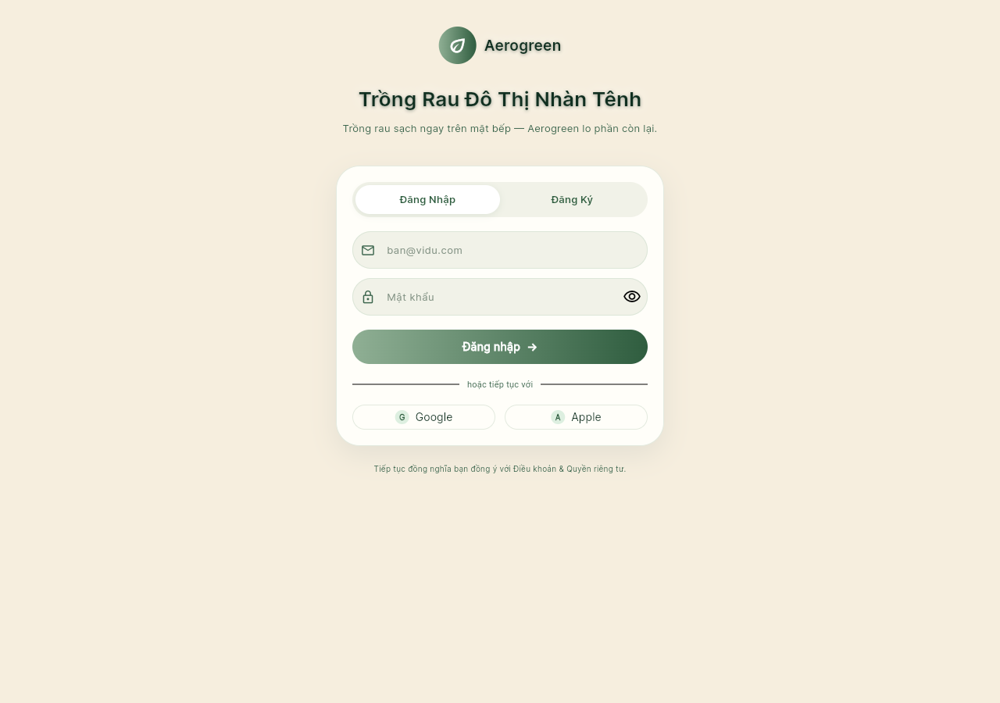
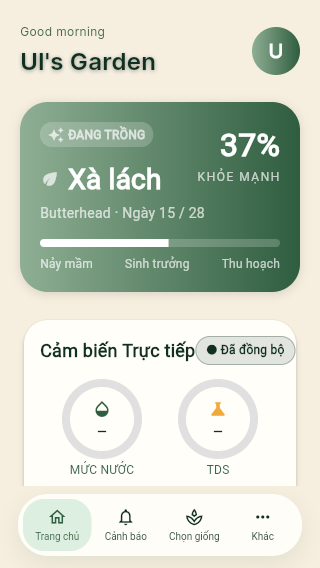

# Kết quả kiểm thử frontend · 18–19/10/2026

Mục này tập hợp báo cáo, ảnh, log và PDF đã có ở local. Việc đưa dữ liệu lên repo không phải một lần chạy test mới.

## Kết quả đã lưu

| Phiên | Kết quả | Bằng chứng |
| --- | --- | --- |
| Flutter · 18/10 | 133 PASS, 0 FAIL; gồm 57 placeholder và 76 ca có assertion dữ liệu/hành vi | [Báo cáo](2026-10-18-frontend/BAO_CAO_TEST_FE.txt), [test cases](2026-10-18-frontend/test-cases.json), [JSON events](2026-10-18-frontend/flutter-test.jsonl) |
| Flutter Chrome · 18/10 | Bị kẹt loading khoảng 3 phút, chủ động dừng, chưa có assertion nghiệp vụ | [Trạng thái](2026-10-18-frontend/browser-status.txt), [log](2026-10-18-frontend/browser-test.log) |
| Dart analyzer · 18/10 | 0 error, 1 warning | [Issues](2026-10-18-frontend/analysis-issues.json), [log](2026-10-18-frontend/flutter-analyze.log) |
| Web UI · 19/10 | **33 ca, 22 PASS, 11 FAIL** | [Báo cáo](2026-10-19-ui/BAO_CAO_UI.txt), [JSON](2026-10-19-ui/results.json), [log](2026-10-19-ui/runner.log), [exit code](2026-10-19-ui/exit-code.txt) |

UI có 33 ca riêng biệt qua ba viewport. Các lượt xác minh/chụp lại tạo tổng 39 lượt thực thi; không cộng thành 39 ca riêng. Xem [verification-runs.json](2026-10-19-ui/verification-runs.json) và [môi trường/revision](2026-10-19-ui/environment.json).

## Ảnh lỗi giao diện

[Toàn bộ 70 ảnh](2026-10-19-ui/screenshots/) · [PDF báo cáo lỗi](2026-10-19-ui/Bao_cao_loi_giao_dien_FE_2026-10-19.pdf) · [Bản xem trước PDF](2026-10-19-ui/pdf-preview/)

| Đăng nhập | Trang tài khoản nhỏ | Ngôn ngữ dashboard |
| --- | --- | --- |
|  |  |  |

Các nhóm lỗi được ghi trong báo cáo: phản hồi khi đăng nhập thất bại/mất kết nối, nội dung trang tài khoản vượt màn hình nhỏ và lựa chọn tiếng Việt chưa đồng bộ dashboard. Xem kết quả từng ca trước khi suy ra nguyên nhân.

## Xem artifact đầy đủ

- [Báo cáo HTML đã xuất](2026-10-19-ui/index.html): tải cùng thư mục ảnh về máy để mở; GitHub hiển thị mã HTML.
- [Playwright HTML report](../../testing/reports/frontend/e2e/2026-10-19/raw/playwright-report/index.html): tải toàn bộ thư mục `playwright-report/` và mở bằng Playwright report viewer.
- [Test results và trace](../../testing/reports/frontend/e2e/2026-10-19/raw/test-results/), [visual checks](../../testing/reports/frontend/e2e/2026-10-19/raw/visual-results/), [language checks](../../testing/reports/frontend/e2e/2026-10-19/raw/language-results/) và [ma trận JSON](../../testing/reports/frontend/e2e/2026-10-19/raw/matrices/).
- [Bằng chứng cũ ngày 13/10](../../testing/reports/archive/2026-10-13/): giữ coverage, TRX và log, tách khỏi các phiên mới.
- [Manifest công bố](../../testing/reports/evidence-manifest.json): đường dẫn nguồn, đường dẫn trên nhánh, kích thước, SHA-256 và cờ đã che credential.

Bản công bố đã thay mật khẩu/token phiên test bằng `[REDACTED]`, bao gồm nội dung trace và ZIP nhúng trong HTML. File gốc local không bị thay đổi; outcome, số ca và ảnh được giữ nguyên. Không đưa fixture `.auth/`, SDK, dependency, cấu hình IDE hoặc công cụ cài đặt môi trường lên nhánh.
