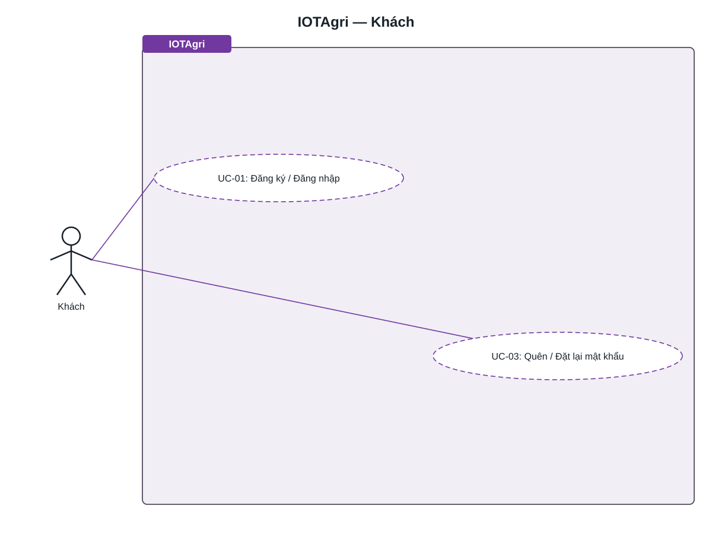
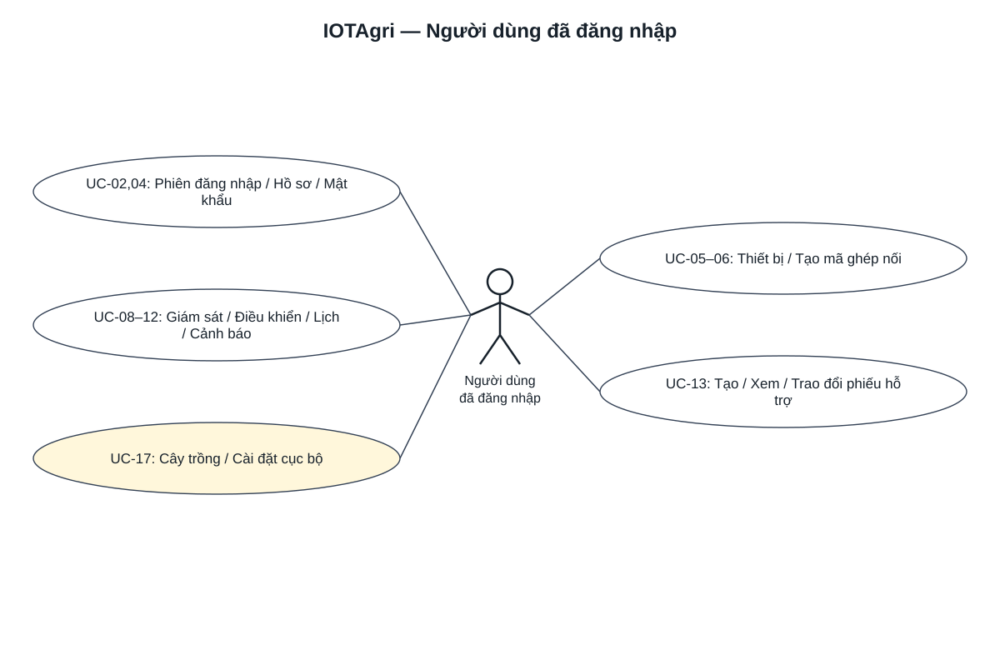
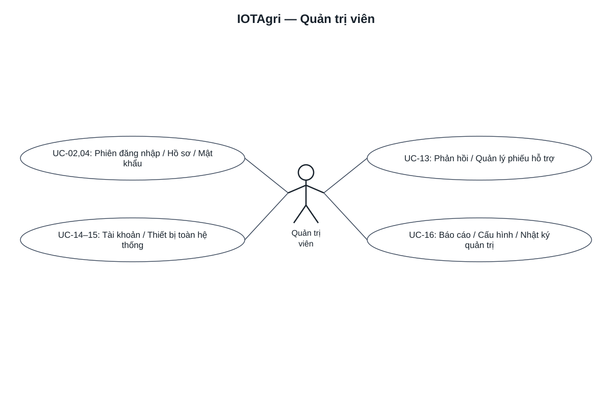
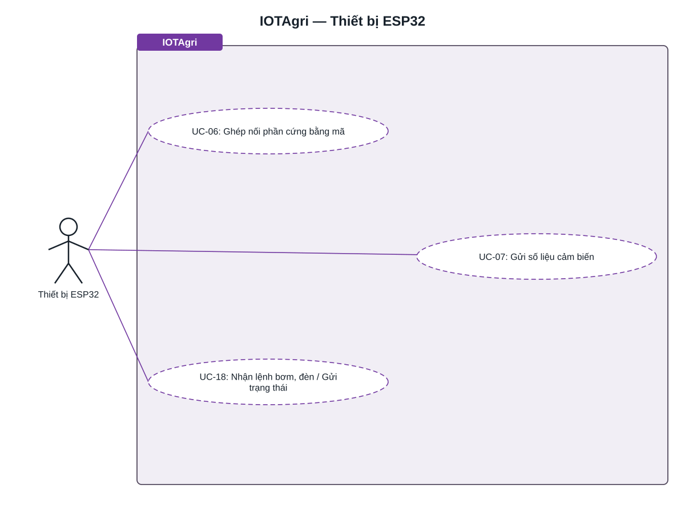
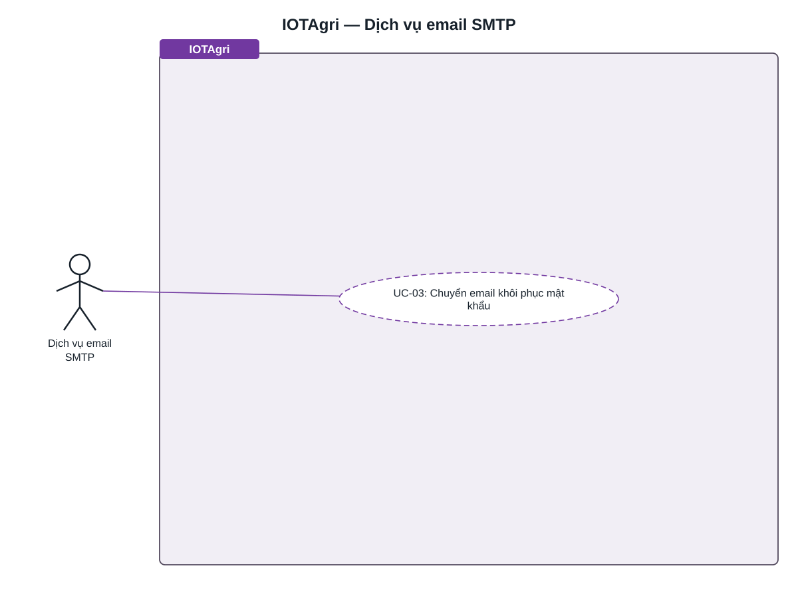

# Use Case — Tác nhân và đặc tả luồng

[← Mục lục](../README.md) · [SRS](../requirements/SRS.md) · [Sơ đồ đầy đủ](../diagrams/project-diagrams.md)

Baseline 27/10/2026. Mỗi sơ đồ đặt actor ở giữa và trình bày toàn bộ hành động của actor trong một ảnh ngang; danh mục dưới đây tách luồng và gắn ID yêu cầu. Đăng nhập là tiền điều kiện, không vẽ `include` vào mọi use case. Không mô tả Admin kế thừa User trong Identity.

## Sơ đồ tổng quan

Mỗi actor ở trung tâm một ảnh riêng, tên nằm dưới hình người que. Các use case tỏa ra hai bên, nối trực tiếp bằng đoạn thẳng và không có khung bao. Mở từng ảnh để xem toàn bộ hành động của actor cùng lúc.

### Khách

### Người dùng đã đăng nhập

### Quản trị viên

### Thiết bị ESP32

### Dịch vụ email SMTP

Xem [sơ đồ chi tiết từng actor](../diagrams/project-diagrams.md#use-case) hoặc [ảnh tổng hợp](../diagrams/rendered/use-case-overview.svg).

Nguồn UML: [tổng quan](../diagrams/use-case-overview.puml) · [chi tiết](../diagrams/use-case.puml). Các use case chung như hồ sơ/phiên xuất hiện ở cả User và Admin, không thể hiện kế thừa vai trò. Màu vàng là chức năng cục bộ/mock. ESP32 và SMTP là actor ngoài hệ thống, dùng cùng ký hiệu actor UML.

## Danh mục

| ID | Mục tiêu | Tác nhân | Yêu cầu |
| --- | --- | --- | --- |
| [UC-01](#uc-01) | Đăng ký / đăng nhập | Khách | FR-01 |
| [UC-02](#uc-02) | Làm mới phiên / đăng xuất | User, Admin | FR-02 |
| [UC-03](#uc-03) | Quên / đặt lại mật khẩu | Khách, SMTP | FR-03 |
| [UC-04](#uc-04) | Hồ sơ / đổi mật khẩu | User, Admin | FR-04 |
| [UC-05](#uc-05) | Quản lý thiết bị | User | FR-05 |
| [UC-06](#uc-06) | Ghép nối ESP32 | User, ESP32 | FR-06 |
| [UC-07](#uc-07) | Tiếp nhận telemetry | ESP32 | FR-07 |
| [UC-08](#uc-08) | Dashboard / lịch sử cảm biến | User | FR-08 |
| [UC-09](#uc-09) | Điều khiển bơm / lịch sử lệnh | User, ESP32 | FR-09 |
| [UC-10](#uc-10) | Quản lý lịch bơm | User | FR-10 |
| [UC-11](#uc-11) | Điều khiển / đặt lịch đèn | User, ESP32 | FR-11 |
| [UC-12](#uc-12) | Cảnh báo thiết bị | User | FR-12 |
| [UC-13](#uc-13) | Trao đổi hỗ trợ | User, Admin | FR-13 |
| [UC-14](#uc-14) | Quản lý tài khoản | Admin | FR-14 |
| [UC-15](#uc-15) | Quản lý thiết bị toàn hệ thống | Admin | FR-15 |
| [UC-16](#uc-16) | Báo cáo / cấu hình / audit | Admin | FR-16 |
| [UC-17](#uc-17) | Cây trồng / cài đặt cục bộ | User trên Flutter | FR-17 |
| [UC-18](#uc-18) | Thực thi actuator và bảo vệ tại ESP32 | ESP32 | FR-18 |

## Đặc tả

### UC-01 — Đăng ký / đăng nhập

| Thành phần | Nội dung |
| --- | --- |
| Tác nhân / yêu cầu | Khách / FR-01 |
| Tiền điều kiện | Email, mật khẩu và thông tin đăng ký hợp lệ. |
| Luồng chính | Nhập thông tin → backend kiểm tra Identity → tạo tài khoản User hoặc cấp cặp token. |
| Ngoại lệ | Email trùng 409; sai thông tin đăng nhập/khóa 401; lỗi validation 400. |
| Hậu điều kiện | Tài khoản hoặc phiên đăng nhập được tạo. |

### UC-02 — Làm mới phiên / đăng xuất

| Thành phần | Nội dung |
| --- | --- |
| Tác nhân / yêu cầu | User, Admin / FR-02 |
| Tiền điều kiện | Có refresh token; logout cần JWT. |
| Luồng chính | Gửi refresh → xác thực token/user → thu hồi token cũ và tạo cặp mới; logout thu hồi token của người gọi. |
| Ngoại lệ | Refresh không active trả 401; logout token không active vẫn 204. |
| Hậu điều kiện | Refresh token cũ không tiếp tục tạo phiên; access JWT có thể còn hiệu lực. |

### UC-03 — Quên / đặt lại mật khẩu

| Thành phần | Nội dung |
| --- | --- |
| Tác nhân / yêu cầu | Khách, SMTP / FR-03 |
| Tiền điều kiện | Có email nhận thư; reset cần token. |
| Luồng chính | Gửi email → backend tạo link Identity → SMTP chuyển thư → mở link và nhập mật khẩu mới → reset và thu hồi refresh token. |
| Ngoại lệ | 202 không tiết lộ email tồn tại; 429 khi quá quota; token lỗi 400; SMTP lỗi vẫn không tiết lộ tài khoản. |
| Hậu điều kiện | Mật khẩu được cập nhật khi reset thành công; cần đăng nhập lại. |

### UC-04 — Hồ sơ / đổi mật khẩu

| Thành phần | Nội dung |
| --- | --- |
| Tác nhân / yêu cầu | User, Admin / FR-04 |
| Tiền điều kiện | JWT hợp lệ. |
| Luồng chính | Xem/sửa hồ sơ hoặc nhập mật khẩu hiện tại và mật khẩu mới → validate → lưu. |
| Ngoại lệ | Dữ liệu hồ sơ hoặc mật khẩu không hợp lệ bị từ chối. |
| Hậu điều kiện | Hồ sơ/mật khẩu mới được lưu; tùy chọn thu hồi refresh sessions. |

### UC-05 — Quản lý thiết bị

| Thành phần | Nội dung |
| --- | --- |
| Tác nhân / yêu cầu | User / FR-05 |
| Tiền điều kiện | JWT và quyền sở hữu đối với thiết bị hiện có. |
| Luồng chính | Tạo hoặc xem/sửa/xóa thiết bị → backend lọc OwnerId → lưu thay đổi. |
| Ngoại lệ | Không tồn tại/khác chủ 404; dữ liệu không hợp lệ bị từ chối. |
| Hậu điều kiện | Thiết bị thuộc user; xóa cascade các bảng con theo ERD. |

### UC-06 — Ghép nối ESP32

| Thành phần | Nội dung |
| --- | --- |
| Tác nhân / yêu cầu | User, ESP32 / FR-06 |
| Tiền điều kiện | Đã tạo thiết bị; có cấu hình broker và mạng. |
| Luồng chính | User tạo mã → ESP32 gửi code/hardwareId → backend đặt lease → cấp credentials broker → hoàn tất claim và xóa mã. |
| Ngoại lệ | Mã sai/hết hạn/đang claim 400; phần cứng trùng 409; broker/config lỗi 503; rate limit claim 10/phút/IP, mặc định từ chối 503. |
| Hậu điều kiện | Thiết bị gắn hardwareId, nhận MQTT credentials; code không dùng lại. |

### UC-07 — Tiếp nhận telemetry

| Thành phần | Nội dung |
| --- | --- |
| Tác nhân / yêu cầu | ESP32 / FR-07 |
| Tiền điều kiện | Thiết bị có DeviceKey và kết nối broker. |
| Luồng chính | ESP32 publish readings → backend tìm device → lưu 7 metric nullable → đánh giá cảnh báo → cập nhật last seen. |
| Ngoại lệ | Key không tồn tại hoặc payload không đọc được không tạo reading hợp lệ. |
| Hậu điều kiện | Reading lưu PostgreSQL và trạng thái quan sát được cập nhật. |

### UC-08 — Dashboard / lịch sử cảm biến

| Thành phần | Nội dung |
| --- | --- |
| Tác nhân / yêu cầu | User / FR-08 |
| Tiền điều kiện | JWT, sở hữu thiết bị; có thể chưa có reading. |
| Luồng chính | Mở overview → chọn thiết bị → xem readings, biểu đồ aggregate hoặc median. |
| Ngoại lệ | Khác chủ 404; interval sai 400; không có mẫu phải phân biệt với giá trị 0. |
| Hậu điều kiện | Hiển thị dữ liệu theo thiết bị và thời gian, không tự suy đoán từ mock. |

### UC-09 — Điều khiển bơm / lịch sử lệnh

| Thành phần | Nội dung |
| --- | --- |
| Tác nhân / yêu cầu | User, ESP32 / FR-09 |
| Tiền điều kiện | JWT, sở hữu, telemetry mới; bật bơm cần mực nước an toàn. |
| Luồng chính | Nhập trạng thái/duration/commandId → kiểm tra an toàn và lịch → lưu Pending → publish MQTT → ESP32 thực thi, ACK → cập nhật lịch sử. |
| Ngoại lệ | 409 khi offline/stale, nước không đủ, trùng trạng thái, lịch giữ bơm hoặc ID xung đột; MQTT lỗi 503 và Failed. |
| Hậu điều kiện | Có lịch sử lệnh; chỉ ACK phù hợp mới là bằng chứng phản hồi thiết bị. |

### UC-10 — Quản lý lịch bơm

| Thành phần | Nội dung |
| --- | --- |
| Tác nhân / yêu cầu | User / FR-10 |
| Tiền điều kiện | JWT, sở hữu; scheduler phải bật để dispatch. |
| Luồng chính | Tạo/sửa/xóa lịch thứ, giờ, timezone, duration, tùy chọn cửa sổ/ngày → validate → lưu → dịch vụ phát lệnh đến hạn. |
| Ngoại lệ | Chồng lịch bật hoặc thông số không hợp lệ bị từ chối; occurrence hết cửa sổ không được phát lại như một lượt mới. |
| Hậu điều kiện | Lịch lưu DB; occurrence/lệnh được theo dõi khi thực sự dispatch. |

### UC-11 — Điều khiển / đặt lịch đèn

| Thành phần | Nội dung |
| --- | --- |
| Tác nhân / yêu cầu | User, ESP32 / FR-11 |
| Tiền điều kiện | JWT và sở hữu; broker sẵn sàng. |
| Luồng chính | Gửi commandId/isOn hoặc CRUD lịch → publish → nhận light-status → đọc trạng thái. |
| Ngoại lệ | ID rỗng 400, MQTT không sẵn sàng 503; restart backend có thể mất trạng thái đèn trong bộ nhớ. |
| Hậu điều kiện | Lịch lưu DB; lệnh đèn không có bảng lịch sử, 202 chỉ báo đã nhận. |

### UC-12 — Cảnh báo thiết bị

| Thành phần | Nội dung |
| --- | --- |
| Tác nhân / yêu cầu | User / FR-12 |
| Tiền điều kiện | JWT, sở hữu; có reading để đánh giá. |
| Luồng chính | Đọc/sửa ngưỡng → telemetry vượt ngưỡng tạo cảnh báo → xem lịch sử/resolve. |
| Ngoại lệ | Null dùng ngưỡng mặc định; mực nước phải trong miền hợp lệ; missing metric không được tự coi là an toàn. |
| Hậu điều kiện | Cảnh báo được lưu; không trùng active theo device/type. |

### UC-13 — Trao đổi hỗ trợ

| Thành phần | Nội dung |
| --- | --- |
| Tác nhân / yêu cầu | User, Admin / FR-13 |
| Tiền điều kiện | JWT; user chỉ truy cập ticket của mình, admin dùng AdminOnly. |
| Luồng chính | User tạo subject/category/message → bổ sung tin nhắn → admin phản hồi, chuyển trạng thái/ưu tiên. |
| Ngoại lệ | Sai giới hạn văn bản/chuyển trạng thái bị từ chối; thiết bị gắn ticket phải thuộc user khi tạo. |
| Hậu điều kiện | Ticket và hội thoại lưu DB, UpdatedAt phản ánh cập nhật. |

### UC-14 — Quản lý tài khoản

| Thành phần | Nội dung |
| --- | --- |
| Tác nhân / yêu cầu | Admin / FR-14 |
| Tiền điều kiện | JWT có role Admin. |
| Luồng chính | Xem/tìm tài khoản → chọn User/Admin hoặc lock/unlock → kiểm tra bảo vệ admin → cập nhật và ghi audit. |
| Ngoại lệ | 403 nếu thiếu quyền; không tự đổi role/khóa mình; không loại admin cuối. |
| Hậu điều kiện | Quyền/lock cập nhật; không hứa JWT cũ bị hủy ngay. |

### UC-15 — Quản lý thiết bị toàn hệ thống

| Thành phần | Nội dung |
| --- | --- |
| Tác nhân / yêu cầu | Admin / FR-15 |
| Tiền điều kiện | JWT Admin. |
| Luồng chính | Xem toàn bộ thiết bị/reading/pump history → đổi owner khi cần → lưu audit. |
| Ngoại lệ | Sai target hoặc owner không hợp lệ bị từ chối; không dùng API owner để vượt sở hữu. |
| Hậu điều kiện | Owner mới được áp dụng; dữ liệu thiết bị vẫn gắn cùng DeviceId. |

### UC-16 — Báo cáo / cấu hình / audit

| Thành phần | Nội dung |
| --- | --- |
| Tác nhân / yêu cầu | Admin / FR-16 |
| Tiền điều kiện | JWT Admin. |
| Luồng chính | Xem overview/status/report hoặc tải CSV; xem audit; sửa ngưỡng mặc định. |
| Ngoại lệ | 403 nếu thiếu role; ngưỡng không hợp lệ bị từ chối. |
| Hậu điều kiện | Báo cáo được trả về; cấu hình lưu singleton, tác động ngưỡng mặc định. |

### UC-17 — Cây trồng / cài đặt cục bộ

| Thành phần | Nội dung |
| --- | --- |
| Tác nhân / yêu cầu | User trên Flutter / FR-17 |
| Tiền điều kiện | Có ứng dụng và bộ nhớ cục bộ. |
| Luồng chính | Chọn cây trong catalog mock → lưu ngày bắt đầu vào SharedPreferences; chỉnh cài đặt ứng dụng. |
| Ngoại lệ | Không có backend vụ trồng/harvest; mockHarvests chỉ là dữ liệu trình diễn. |
| Hậu điều kiện | Lựa chọn cục bộ; không tạo bảng PostgreSQL hoặc đồng bộ đa thiết bị. |

### UC-18 — Thực thi actuator và bảo vệ tại ESP32

| Thành phần | Nội dung |
| --- | --- |
| Tác nhân / yêu cầu | ESP32 / FR-18 |
| Tiền điều kiện | Firmware đã cấu hình, phần cứng và mạng phù hợp. |
| Luồng chính | Subscribe command → kiểm tra payload, command gần nhất, thời gian/nước với bơm → điều khiển GPIO → ACK → timer/safety theo dõi dừng. |
| Ngoại lệ | Clock chưa sync, duration lỗi, hết lịch hoặc nước không an toàn có thể bị từ chối; chưa chứng minh toàn bộ tình huống reorder/replay/reboot. |
| Hậu điều kiện | Relay/state và ACK phản ánh xử lý firmware; cần test hardware độc lập. |
