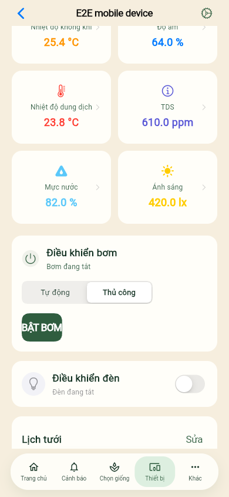

# E2E toàn hệ thống — 30/10/2026

**32 ca: 30 PASS, 2 FAIL, 0 skipped.** Exit code **1**; cleanup **0**.
Phiên `1793358159401-35b398` chạy trên code ứng dụng nguyên bản; không sửa backend
hoặc frontend để đổi kết quả. Đây là bằng chứng của phiên đã chạy, không phải
kết quả được tạo ra khi pull nhánh `Test`.

| Nhóm | PASS | FAIL |
|---|---:|---:|
| API / PostgreSQL / MQTT / SMTP | 16 | 1 |
| Desktop 1280×900 | 5 | 0 |
| Mobile 390×844 | 4 | 1 |
| Small mobile 320×568 | 5 | 0 |

Source gốc được ghi ở revision `accd272a6b40af39776275fc1461487daa7b9529`.
Runner trên nhánh `Test` tải commit có trên remote
`bb2900380f2c2d15decdbc4b458584b6a57e66fb`; hai revision này có backend/frontend
giống nhau, khác biệt chỉ ở `.vscode/settings.json`.

## Hai ca chưa đạt

- **SYS-13:** lịch bơm bắt đầu sau khoảng 10 giây, thời lượng 3 giây; simulator
  không nhận lệnh sau 30 giây. Chu kỳ poll test là 5 giây. Cần kiểm tra quan hệ
  giữa thời lượng ngắn và cửa sổ dispatch; chưa chốt nguyên nhân cuối cùng.
- **WEB-04 / mobile:** automation không mở được lựa chọn `30 giây` sau khi bấm
  bơm. Nút vẫn hiển thị; semantics gộp tiêu đề/trạng thái/nút. Chưa đủ bằng chứng
  kết luận chức năng bơm thực tế bị lỗi. Giữ nguyên FAIL để tiếp tục kiểm chứng.

| Lịch bơm | Mobile |
|---|---|
| [Error context](raw/test-results/system-SYS-13-pump-schedul-5e7e8-nce-and-device-acknowledges-system/error-context.md) | [Error context](raw/test-results/browser-WEB-04-MQTT-teleme-35ecc-mplete-the-real-system-loop-mobile/error-context.md) |

## Bằng chứng đã công bố

[Kết quả JSON](raw/results.json) · [JUnit](raw/junit.xml) · [Runner log](raw/runner.log) ·
[Log dịch vụ](raw/services.log) · [Metadata phiên](raw/run.json) ·
[HTML Playwright](raw/playwright-report/index.html) · [Manifest SHA-256](evidence-manifest.json)

Toàn bộ cây tài nguyên HTML, screenshot, trace ZIP và video của phiên này nằm
trong `raw/`. Token/mật khẩu test đã được che trong text, trace ZIP và ZIP nhúng
trong HTML; tên tài nguyên được giữ để report/trace vẫn mở được. Kết quả PASS/FAIL
không bị sửa. Tải toàn thư mục hoặc clone nhánh để xem HTML; GitHub không chạy
HTML report trực tiếp. Có thể mở ZIP bằng Playwright Trace Viewer.

Chạy lại từ gốc nhánh `Test` bằng `node testing/e2e/scripts/run.cjs`.
Xem [hướng dẫn môi trường và phạm vi](../../../e2e/README.md).
